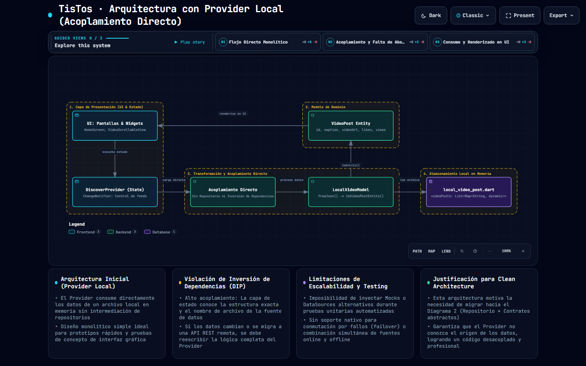
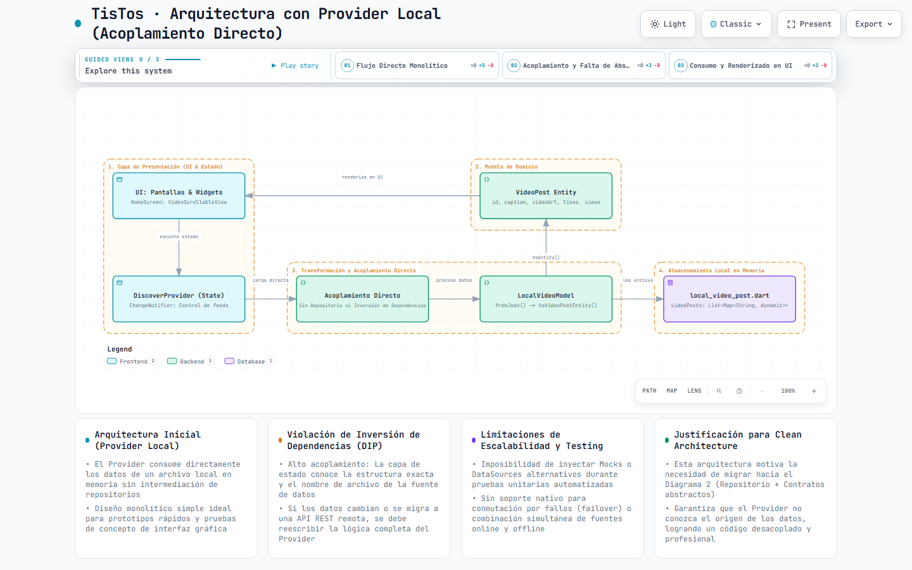
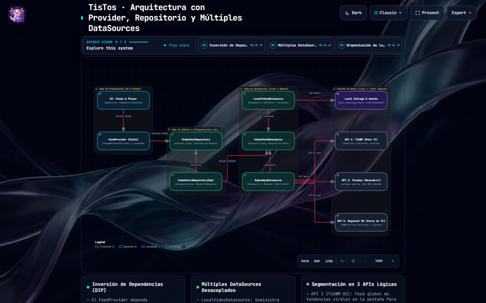
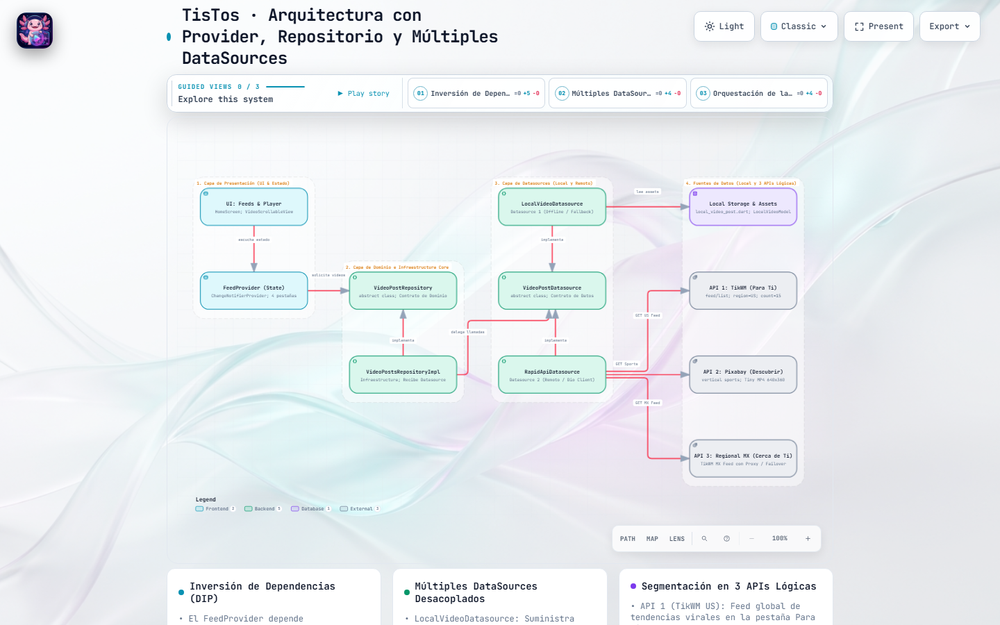

# Práctica 04: TisTos — Aplicación de Reproducción de Videos Verticales

- **Asignatura:** Desarrollo Móvil Integral (10° Cuatrimestre)
- **Carrera:** Ingeniería en Desarrollo y Gestión de Software
- **Docente:** M.T.I. Marco Antonio Ramírez Hernández
- **Alumno:** Francisco García García
- **Matrícula:** 230758
- **Periodo:** Septiembre - Diciembre 2026
- **Valor:** 30 Firmas

<div align="center">

[](https://appetize.io/app/b_o3aughhl5pz2mzfgg7nkygbzyy)
[](appetize/README.md)

</div>

---

##  Objetivo de la Práctica

Diseñar, estructurar y desarrollar una aplicación móvil interactiva de alto rendimiento en **Flutter** que simule la experiencia de usuario y funcionalidad de la plataforma social **TikTok / Instagram Reels**. La aplicación implementa reproducción continua de video mediante desplazamiento vertical (*Vertical PageView*), navegación entre secciones con desplazamiento lateral, controles multimedia avanzados, gestión de temas estacionales automáticos basados en fechas y arquitectura limpia (**Clean Architecture**) con inversión de dependencias.

El proyecto incorpora un dominio exhaustivo de conceptos avanzados de Flutter:
- **Gestión de Estado Reactiva:** Uso del patrón `Provider` (`ChangeNotifierProvider`, `MultiProvider`).
- **Clean Architecture & SOLID:** Separación estricta de capas (*Domain*, *Infrastructure*, *Presentation*, *Config*) y desacoplamiento mediante contratos e interfaces abstractas (*Dependency Inversion Principle*).
- **Manejo de Assets y Multimedia:** Integración de `video_player`, `audioplayers`, fuentes personalizadas (`google_fonts`) e iconos SVG/PNG.
- **Interacción Gestual:** Detección de toques (`GestureDetector`) para pausar/reanudar, dar like con doble tap y acelerar video a velocidad 2x con pulsación prolongada.
- **Persistencia Local:** Almacenamiento seguro en disco con `shared_preferences` para me gustas, favoritos, IDs vistos y forzado de temporadas.
- **Consumo de Servicios Web:** Cliente HTTP `Dio` para consumir 3 orígenes lógicos de datos externos (TikWM, Pixabay y Regional Scraper) con tolerancia a fallos (*failover*).

---

##  Tecnologías y Dependencias Utilizadas

| Dependencia / Herramienta | Versión | Propósito en el Proyecto |
| :--- | :---: | :--- |
| **Flutter SDK** | `^3.13.3` | Framework multiplataforma compilado de forma nativa. |
| **Dart SDK** | `^3.13.3` | Lenguaje fuertemente tipado con soporte asíncrono robusto (`Future`, `Stream`). |
| **provider** | `^6.1.5+1` | Gestor de estado para orquestar los feeds (`FeedProvider`) y ajustes de audio (`PlaybackSettings`). |
| **video_player** | `^2.14.1` | Controlador oficial de reproducción y decodificación de video en streaming y local. |
| **dio** | `^5.11.1` | Cliente HTTP avanzado con timeouts (10s/15s), interceptores y headers personalizados. |
| **shared_preferences** | `^2.5.6` | Almacenamiento persistente en dispositivo para likes, favoritos y deduplicación. |
| **audioplayers** | `^6.8.1` | Reproducción de jingles y efectos sonoros estacionales en splash screen. |
| **google_fonts** | `^9.0.0` | Carga dinámica de tipografías temáticas (`Creepster`, `Mountains of Christmas`, etc.). |
| **animate_do** | `^5.1.0` | Micro-animaciones de entrada, rebotes de likes y transiciones visuales. |
| **flutter_dotenv** | `^6.0.1` | Gestión de variables de entorno seguras para credenciales de API (`.env`). |
| **intl** | `^0.20.3` | Formateo numérico compacto para vistas y likes (`1.5K`, `2.3M`). |
| **Archify** | `2.17.0` | Generación de diagramas de arquitectura interactivos en SVG/HTML con diseño Apple Liquid Glass. |

---

##  Guía de Instalación y Ejecución

### Requisitos Previos
1. **Flutter SDK** configurado en el `PATH` (`flutter doctor` sin errores críticos).
2. Dispositivo físico Android (con depuración USB activa) o Emulador con aceleración de hardware.
3. Archivo `.env` en la raíz de `Practica04/tistos/` con las llaves de configuración.

### Pasos de Despliegue

1. **Clonar el repositorio:**
   ```bash
   git clone https://github.com/F-Anks/10A_DMI_230758.git
   ```

2. **Cambiar a la rama de la práctica:**
   ```bash
   git checkout Practica-04
   ```

3. **Navegar a la carpeta del proyecto:**
   ```bash
   cd Practica04/tistos
   ```

4. **Configurar el archivo de variables de entorno:**
   Copia la plantilla `.env.template` a `.env`:
   ```bash
   cp .env.template .env
   ```

5. **Descargar e instalar dependencias:**
   ```bash
   flutter pub get
   ```

6. **Compilar y ejecutar la aplicación:**
   ```bash
   flutter run
   ```

> [!TIP]
> Si ejecutas en un dispositivo físico, asegúrate de tener habilitada la opción **"Instalar vía USB"** en las Opciones de Desarrollador.

---

##  Arquitectura del Proyecto 

El proyecto sigue rigurosamente el patrón **Clean Architecture**, dividiendo las responsabilidades en cuatro capas principales:

```
 lib/
├── 📂 config/                                 ← Configuración transversal y utilidades
│   ├── 📂 constants/                          ← Constantes de entorno (Environment)
│   ├── 📂 helpers/                            ← Formateadores, deduplicador y DynamicIconHelper
│   └── 📂 theme/                              ← Motor de temas estacionales (AppTheme)
│
├── 📂 domain/                                 ← Capa de Dominio (Reglas de negocio puras)
│   ├── 📂 datasources/                        ← Contrato abstracto (VideoPostDatasource)
│   ├── 📂 entities/                           ← Entidad inmutable (VideoPost)
│   └── 📂 repositories/                       ← Contrato abstracto (VideoPostRepository)
│
├── 📂 infrastructure/                         ← Capa de Infraestructura y Datos
│   ├── 📂 datasources/                        ← Implementaciones (LocalVideoDatasource, RapidApiDatasource)
│   ├── 📂 models/                             ← Mappers de deserialización (LocalVideoModel)
│   ├── 📂 repositories/                       ← Implementación (VideoPostsRepositoryImpl)
│   └── 📂 services/                           ← Servicios nativos y SharedPreferences (LocalStorageService)
│
├── 📂 presentation/                           ← Capa de Presentación (UI & Estado)
│   ├── 📂 models/                             ← Modelos de vista (FeedSection, FeedState)
│   ├── 📂 providers/                          ← Gestores de estado (FeedProvider, PlaybackSettings)
│   ├── 📂 screens/                            ← Vistas principales (HomeScreen, ForYou, Discover, NearYou, Favorites)
│   └── 📂 widgets/                            ← Componentes reutilizables (LiquidGlassTabBar, VideoScrollableView, FullScreenPlayer)
│
├── 📂 shared/                                 ← Recursos estáticos compartidos
│   └── 📂 data/                               ← Dataset local (local_video_post.dart)
│
└── 📄 main.dart                               ← Punto de entrada e inicialización de MultiProvider
```

---

##  Diagramas de Arquitectura del Proyecto

Para dar cumplimiento formal al requerimiento de la práctica, se diseñaron y compilaron **2 diagramas de arquitectura interactivos** con el motor **Archify**, aplicando un sistema de diseño premium **Apple Liquid Glass** (soporte dual Claro/Oscuro con tecla `T`, físicas elásticas 3D y tarjetas modales expandibles):

###  Diagrama 1: Arquitectura con Provider Local (Acoplamiento Directo)
* **Objetivo:** Ilustra el enfoque inicial de la aplicación, donde el Provider consume directamente los archivos y datasets locales en memoria (`local_video_post.dart`) sin intermediación de contratos de repositorio.
* **Características:** Explica el alto acoplamiento y la violación del principio de Inversión de Dependencias (DIP).
* **Exploración:**
  -  **[Ver Diagrama 1 en Vivo (GitHub Pages)](https://f-anks.github.io/10A_DMI_230758/Practica04/tistos/architecture/tistos-local-provider-architecture.html)**
  -  **[Archivo Local](architecture/tistos-local-provider-architecture.html)** | **[Esquema JSON](architecture/tistos-local-provider-architecture.json)**

#### Capturas del Diagrama 1 (Arquitectura con Provider Local):

| Modo Oscuro (Apple Liquid Glass) | Modo Claro (High Contrast) |
| :---: | :---: |
|  |  |

---

###  Diagrama 2: Clean Architecture con Repositorio y Múltiples DataSources
* **Objetivo:** Representa la arquitectura desacoplada final, donde `FeedProvider` depende únicamente del contrato abstracto `VideoPostRepository`, delegando a `VideoPostsRepositoryImpl` la orquestación polimórfica entre el `LocalVideoDatasource` (offline) y el `RapidApiDatasource` (remoto con 3 APIs lógicas).
* **Características:** Demuestra la inversión de dependencias, extensibilidad, modularidad y facilidad para pruebas unitarias con Mocks.
* **Exploración:**
  -  **[Ver Diagrama 2 en Vivo (GitHub Pages)](https://f-anks.github.io/10A_DMI_230758/Practica04/tistos/architecture/tistos-repository-datasources-architecture.html)**
  -  **[Archivo Local](architecture/tistos-repository-datasources-architecture.html)** | **[Esquema JSON](architecture/tistos-repository-datasources-architecture.json)**

#### Capturas del Diagrama 2 (Arquitectura con Repositorio y DataSources):

| Modo Oscuro (Apple Liquid Glass) | Modo Claro (High Contrast) |
| :---: | :---: |
|  |  |

---

###  Diagrama Complementario: Orquestación de Red y Deduplicación de las 3 APIs
* **Objetivo:** Diagrama de ingeniería centrado en el despacho secuencial anti-rate-limit de peticiones HTTP, timeouts de red y normalización hacia la entidad `VideoPost`.
* **Exploración:**
  -  **[Ver Diagrama de APIs en Vivo (GitHub Pages)](https://f-anks.github.io/10A_DMI_230758/Practica04/tistos/architecture/tistos-apis-architecture.html)**
  -  **[Archivo Local](architecture/tistos-apis-architecture.html)** | **[Esquema JSON](architecture/tistos-apis-architecture.json)**

---

##  Funcionalidades Específicas Implementadas

### 1. Sistema de Temas Estacionales Dinámicos y Audio Reactivo
- **Detección Automática por Calendario:** Al iniciar, la aplicación lee la fecha del sistema mediante `DateTime.now()` y activa el tema correspondiente:
  -  **Halloween (Octubre):** Paleta naranja/negro, tipografía `Creepster`, icono temático y audio tenebroso de bienvenida.
  -  **Navidad (Diciembre):** Paleta verde/rojo/dorado, tipografía `Mountains of Christmas`, iconos de campanas y música navideña.
  -  **San Valentín (Febrero):** Paleta rosa/carmesí, tipografía `Dancing Script` y melodía romántica.
  -  **Aniversario (Septiembre):** Paleta violeta/cian y fanfarria festiva.
  -  **Normal (Resto del año):** Paleta oscura minimalista estilo TikTok nativo.
- **Mecanismo de Prueba Manual:** Drawer lateral interactivo que permite forzar cualquiera de las temporadas en tiempo real, persistiendo la selección en `SharedPreferences`.
- **Iconos Dinámicos de Android (`MethodChannel`):** Cambio del icono del lanzador en la pantalla de inicio del sistema Android mediante `activity-alias` en el `AndroidManifest.xml`, con cola de ejecución atómica en `onStop()` para prevenir iconos duplicados.

### 2. Secciones del Feed con Navegación Lateral y Vertical
- **Navegación Horizontal (Tabs):** Integración de `LiquidGlassTabBar` con efecto de cristal flotante para navegar entre:
  - **Para Ti (For You):** Tendencias globales virales en streaming continuo.
  - **Cerca de Ti (Near You):** Contenido con segmentación regional.
  - **Descubrir (Discover):** Videos temáticos de acción, deportes y naturaleza.
  - **Favoritos (Favorites):** Colección privada guardada por el usuario.
- **Desplazamiento Vertical:** `PageView.builder` con física `BouncingScrollPhysics`, permitiendo cambio instantáneo de video con precarga y destrucción controlada de instancias para optimizar memoria RAM.

### 3. Control de Audio Global (Mute / Unmute)
- Administrado de forma centralizada por `PlaybackSettings` (`ChangeNotifier`).
- Al presionar el botón de volumen en la columna flotante inferior derecha, conmuta instantáneamente el audio de todos los reproductores de la app y actualiza el icono reactivo.

### 4. Persistencia de Likes y Favoritos en Local Storage
- **Contador Dinámico e Incremental:** Al pulsar el corazón (o hacer doble tap sobre el video):
  - Si no estaba marcado: se suma `+1` like, se activa la animación de latido (`animate_do`) y se guarda en `LocalStorageService`.
  - Si se desmarca: se resta `-1` like y se actualiza el almacenamiento.
- **Colección de Favoritos:** Al marcar el icono de estrella, el video se guarda permanentemente en la lista de favoritos de `SharedPreferences`, estando disponible incluso tras reiniciar la aplicación.

### 5. Descripción Extensa con (... más) y Scroll Vertical
- El widget `VideoBackground` inspecciona la longitud del texto (`caption`).
- Si supera los 80 caracteres o 2 líneas, muestra el botón expandible **"(... más)"**.
- Al expandirse, el panel de descripción cuenta con su propio `SingleChildScrollView` vertical para leer textos completos sin obstruir los controles de reproducción.

### 6. Consumo de 3 DataSources y Respaldo Inteligente (Failover)
1. **API 1 — TikWM US Feed (`For You`):** Peticiones públicas a `https://tikwm.com/api/feed/list` con `region=US` para videos virales en alta calidad MP4 sin marcas de agua.
2. **API 2 — Pixabay Videos (`Discover`):** Búsqueda temático-deportiva en resolución `tiny` (640x360), garantizando bajo consumo de datos y renderizado a 60 FPS en cualquier dispositivo.
3. **API 3 — TikWM Regional MX (`Near You`):** Contenido localizado para México con arquitectura de contingencia de 3 niveles: si la petición regional experimenta saturación, conmuta automáticamente a Pixabay Lugares y finalmente a la reserva local.

### 7. Motor Anti-Repetición (`VideoDeduplicator`)
- Algoritmo que filtra identificadores únicos vistos (`seen_video_ids`).
- Previene que dos videos idénticos o del mismo autor aparezcan de forma consecutiva ("uno debajo del otro"), garantizando un feed variado y dinámico.

---

## Evidencias Visuales y Videos Demostrativos

A continuación se presentan las grabaciones y demostraciones del funcionamiento de la aplicación ejecutada en dispositivo físico:

### 1. Demostración General de la Aplicación
Navegación vertical fluida (*Vertical PageView*), cambio entre pestañas (*For You*, *Near You*, *Discover*, *Favorites*), interacción gestual (doble tap para dar like, pulsación larga para velocidad x2), control de mute/unmute y panel de descripción expandible con scroll.

https://github.com/user-attachments/assets/c969184d-e151-4cda-9950-37851bdff4ab

<br/>

### 2. Splash Screen y Sincronización de Temas Estacionales
Pantalla de bienvenida animada con reloj de arena (*HourglassLoading*), reproducción de audio temático reactivo, selector interactivo de temporadas en tiempo real (Halloween, Navidad, San Valentín, Aniversario, Normal) y sincronización del lanzador de iconos dinámicos.

https://github.com/user-attachments/assets/d10cedd0-b3b8-4741-affc-23f909a9b2de

---

##  Conclusiones Técnicas

1. **Eficiencia de Clean Architecture:** El desacoplamiento estricto entre `VideoPostDatasource` y `VideoPostsRepositoryImpl` permitió integrar múltiples proveedores de video (TikWM, Pixabay y almacenamiento local) sin alterar una sola línea de código en la interfaz de usuario ni en el Provider.
2. **Ciclo de Vida de Controladores Multimedia:** El manejo riguroso de inicialización (`initialize()`), reproducción condicional y liberación (`dispose()`) en `FullScreenPlayer` previene fugas de memoria (*memory leaks*) al desplazarse por feeds infinitos.
3. **Resiliencia ante Fallos de Red:** La implementación de políticas de failover automático y carga escalonada en `FeedProvider` garantiza que la interfaz de usuario nunca se congele con indicadores de carga infinita, manteniendo una experiencia fluida bajo cualquier condición de conectividad.
4. **Persistencia Híbrida:** La combinación de memoria volátil para navegación rápida y almacenamiento clave-valor (`SharedPreferences`) para preferencias e interacciones brinda una sensación de aplicación nativa completa.
