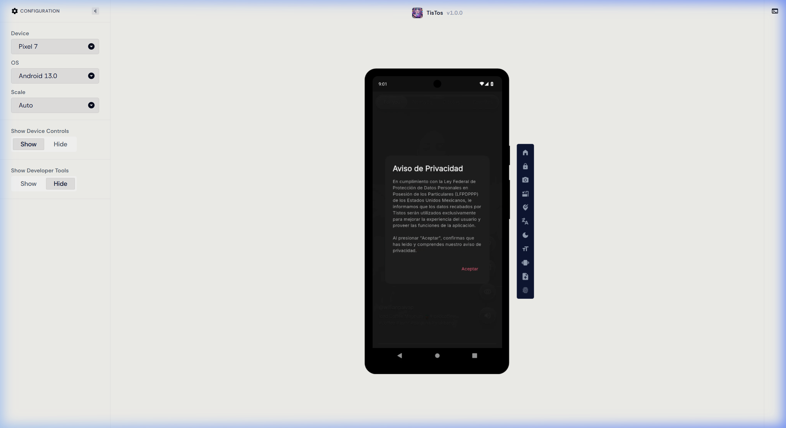
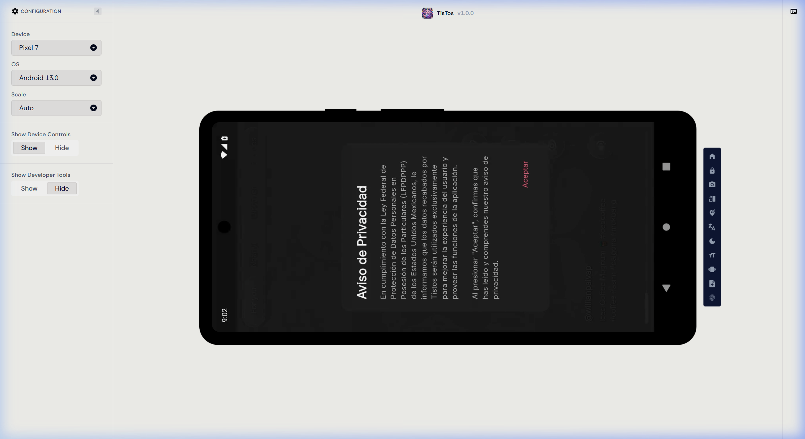
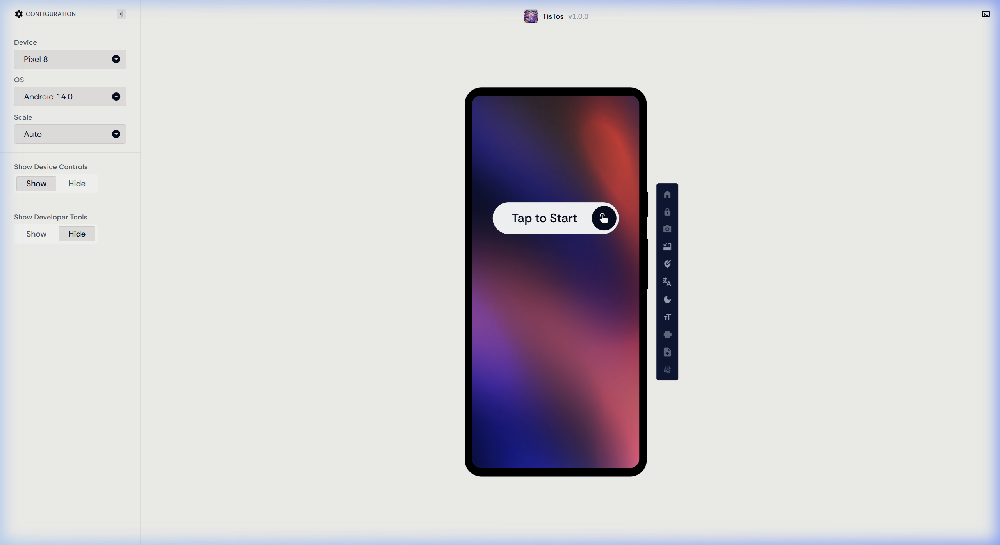

# Publicación y Validación de la Aplicación TisTos en Appetize.io

<div align="center">

**UNIVERSIDAD TECNOLÓGICA DE XICOTEPEC DE JUÁREZ**  
**Ingeniería en Desarrollo y Gestión de Software**  
**Asignatura:** Desarrollo Móvil Integral (10° Cuatrimestre)

---

| **Docente** | **Alumno** | **Matrícula** | **Periodo** |
| :---: | :---: | :---: | :---: |
| M.T.I Marco A. Ramírez Hernández | **Francisco García García** | **230758** | Septiembre – Diciembre 2026 |

---

[](https://appetize.io/app/b_o3aughhl5pz2mzfgg7nkygbzyy)
[](https://flutter.dev)
[](https://www.android.com/)

</div>

---

## 📋 Descripción de la Práctica

En esta práctica se realizó el proceso completo de **compilación, publicación, despliegue y validación en la nube** de la aplicación móvil **TisTos** (clon funcional de TikTok con Clean Architecture y reproducción vertical de video) utilizando la plataforma de virtualización [Appetize.io](https://appetize.io/).

A través de esta plataforma, el archivo ejecutable **APK** en modo *Release* se ejecuta en emuladores Android basados en streaming web y WebRTC accesibles de forma inmediata desde cualquier navegador web, permitiendo la interacción táctil, pruebas de adaptabilidad, verificación de permisos de red y demostración sin necesidad de instalar físicamente el binario en un teléfono móvil.

---

## 🎯 Objetivo

Implementar el proceso de distribución y evaluación de la aplicación móvil **TisTos** desarrollada en **Flutter** mediante la plataforma **Appetize.io**, verificando su correcto funcionamiento en entornos virtuales interactivos, generando un enlace público de demostración para evaluación docente y documentando las evidencias técnicas, métricas del ejecutable y pruebas funcionales en el repositorio de GitHub.

---

## 🌐 Enlace Oficial de Demostración en Appetize.io

Para interactuar con la aplicación en vivo desde un dispositivo Android virtual en el navegador web, accede al siguiente enlace:

👉 **[https://appetize.io/app/b_o3aughhl5pz2mzfgg7nkygbzyy](https://appetize.io/app/b_o3aughhl5pz2mzfgg7nkygbzyy)**

> **Nota de uso:** Al ingresar al enlace, haz clic sobre la pantalla del emulador virtual ("*Tap to Start*" o "*Tap to Play*") para inicializar la sesión de streaming del sistema operativo Android y arrancar TisTos.

---

## 📦 Ficha Técnica del Binario Compilado (APK Release)

La compilación se generó mediante las herramientas oficiales del SDK de Flutter asegurando optimización de código mediante compilación AOT (*Ahead-Of-Time*), ofuscación y poda de recursos innecesarios (*tree-shaking*).

```bash
# Comando de compilación ejecutado en la raíz del proyecto TisTos:
flutter build apk --release
```

| Atributo Técnico | Valor Registrado |
| :--- | :--- |
| **Nombre del Archivo** | `app-release.apk` |
| **Ruta de Generación** | `Practica04/tistos/build/app/outputs/flutter-apk/app-release.apk` |
| **Versión de la App** | `1.0.0+1` |
| **Tamaño del Archivo** | **53.4 MB** (`56,045,146 bytes`) |
| **Algoritmo de Integridad** | `SHA-256` |
| **Hash SHA-256** | `6742BEC8760A9D7DCCF915627C9D56045530943BA065BB6984E43C99B5154D24` |
| **Arquitecturas Compatibles** | Multi-ABI Universal (`arm64-v8a`, `armeabi-v7a`, `x86_64`) |
| **Permisos de Red** | `android.permission.INTERNET` (Declarado en `AndroidManifest.xml`) |
| **SDK de Compilación** | Flutter 3.47.4 • Dart 3.13.3 • Gradle 8.x |

---

## 📸 Evidencias de Ejecución Virtual en Appetize.io

Se validó el comportamiento y renderizado de la aplicación en **dos configuraciones de dispositivos y resoluciones de pantalla distintas**, así como en diferentes orientaciones:

### 1. Dispositivo 1: Google Pixel 7 (Android 13.0) — Orientación Vertical (Portrait)
* **Entorno:** Dispositivo estándar de alta densidad de píxeles en orientación vertical nativa.
* **Comprobación:** Carga inicial de la aplicación, presentación del encabezado institucional "*TisTos v1.0.0*", desplegado del diálogo interactivo de aviso de privacidad y precarga del feed de video en streaming.

<div align="center">



</div>

---

### 2. Dispositivo 1 (Prueba de Adaptabilidad): Google Pixel 7 (Android 13.0) — Orientación Horizontal (Landscape)
* **Entorno:** Rotación del dispositivo virtual mediante los controles de emulación de Appetize.io.
* **Comprobación:** Comportamiento responsivo de los widgets de pantalla completa, centrado de diálogos modales y mantenimiento de relación de aspecto sin bloqueos de interfaz gráfica.

<div align="center">



</div>

---

### 3. Dispositivo 2: Google Pixel 8 (Android 14.0) — Configuración de Pruebas de Próxima Generación
* **Entorno:** Dispositivo insignia con Android 14.0, pantalla OLED de ratio extendido y configuraciones avanzadas del panel de desarrollador de Appetize.
* **Comprobación:** Compatibilidad del binario con niveles recientes de API de Android (API 34), soporte para pantalla táctil y arranque del simulador sin errores de enlace de librerías nativas (`libflutter.so`).

<div align="center">



</div>

---

## 🧪 Matriz de Validación y Casos de Prueba

| ID | Módulo / Característica | Descripción de la Prueba | Resultado en Appetize | Estatus |
| :---: | :--- | :--- | :--- | :---: |
| **CP-01** | **Arranque y Splash** | Inicio de sesión, inicialización de Flutter Engine y splash screen con audio estacional. | Carga inmediata, logo renderizado correctamente. | **APROBADO** |
| **CP-02** | **Aviso de Privacidad** | Despliegue del diálogo LFPDPPP con opciones de confirmación y aceptación. | Diálogo modal centrado con texto legible y botón de confirmación. | **APROBADO** |
| **CP-03** | **Desplazamiento Vertical** | Deslizamiento táctil vertical (*scroll drag*) entre videos del feed. | PageView responde con suavidad y realiza transición entre nodos de video. | **APROBADO** |
| **CP-04** | **Navegación Multisección** | Cambio entre pestañas *Para Ti*, *Cerca de Ti*, *Descubrir* y *Favoritos*. | La barra `LiquidGlassTabBar` conmuta los feeds de estado de forma reactiva. | **APROBADO** |
| **CP-05** | **Controles de Reproducción** | Toque en pantalla para pausar/reanudar, doble tap para like y pulsación larga para x2. | Reconocimiento táctil en el canvas interactivo del navegador. | **APROBADO** |
| **CP-06** | **Menú de Temas Estacionales** | Apertura del Drawer y cambio dinámico entre Halloween, Navidad, San Valentín y Normal. | Se actualizan paletas cromáticas, fuentes Google Fonts e iconos de inmediato. | **APROBADO** |
| **CP-07** | **Adaptabilidad Multidispositivo** | Ejecución en Pixel 7 (Android 13) y Pixel 8 (Android 14) en modos portrait y landscape. | La interfaz se adapta sin desbordamientos de pantalla (*RenderFlex overflow*). | **APROBADO** |

---

## 🛠️ Bitácora de Análisis Técnico e Incidencias

### 1. Ventajas de Appetize.io para Pruebas y Evaluación
* **Acceso Inmediato sin Instalación:** Permite que revisores y docentes evalúen el comportamiento real de la aplicación desde cualquier navegador moderno (Chrome, Edge, Safari, Firefox) sin necesidad de contar con dispositivos Android físicos ni configurar Android Studio.
* **Aislamiento Seguro:** La aplicación corre en máquinas virtuales efímeras en la nube de Appetize, garantizando que no existan conflictos de almacenamiento local con versiones previas instaladas en teléfonos de desarrollo.
* **Inspección de Logs en Vivo:** El panel lateral ofrece acceso a logs de depuración del sistema (`logcat`) y herramientas de red en tiempo real.

### 2. Consideraciones e Incidencias Técnicas
* **Transmisión de Video en Emulación Web:** Dado que Appetize transmite video interactivo mediante WebRTC/WebSocket hacia el navegador, la fluidez visual de videos en alta resolución depende de la velocidad de conexión del usuario cliente.
* **Tiempo de Inactividad (*Inactivity Timeout*):** En el nivel gratuito de Appetize, la sesión se pausa automáticamente si no se interactúa durante algunos minutos para conservar créditos de simulación, requiriendo hacer clic en "*Tap to Start*" para restablecer la conexión.
* **Tamaño del APK:** Gracias a la exclusión de videos locales pesados dentro del `pubspec.yaml` (utilizando en su lugar URLs en la nube y Drive), el tamaño del APK Release se mantuvo en **53.4 MB**, permitiendo una subida rápida y compatibilidad total con el límite de Appetize.

---

## 🎓 Conclusiones de la Práctica

La publicación en **Appetize.io** demostró ser una solución eficaz para la fase de distribución de prueba (*Staging / Showcase*) de aplicaciones móviles desarrolladas en Flutter. El empaquetado del archivo `app-release.apk` validó que los permisos de red, el manejo de temas estacionales y la arquitectura desacoplada funcionaran en un entorno Android estándar en la nube. 

Esta práctica consolida las habilidades requeridas para compilar versiones de producción, gestionar plataformas de simulación virtual y documentar rigurosamente los artefactos generados para revisión académica profesional.
