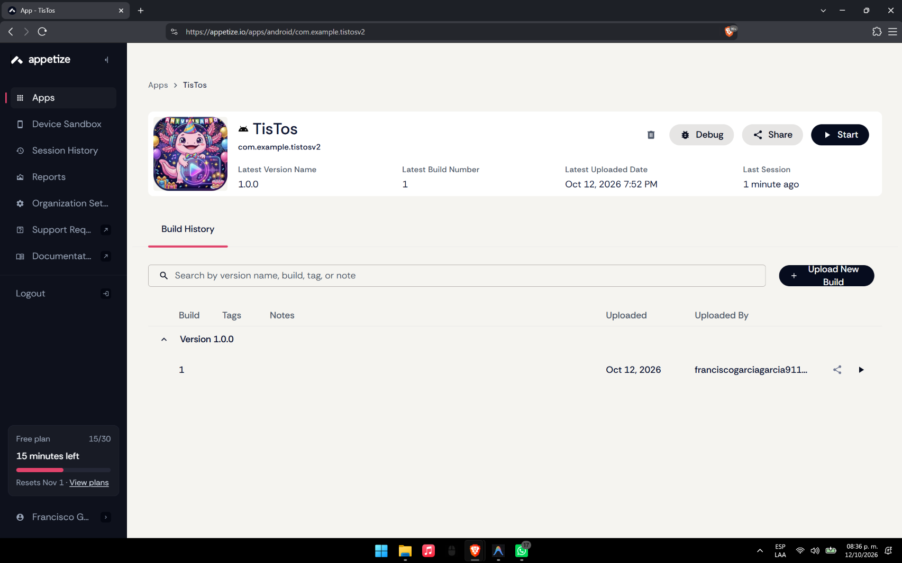
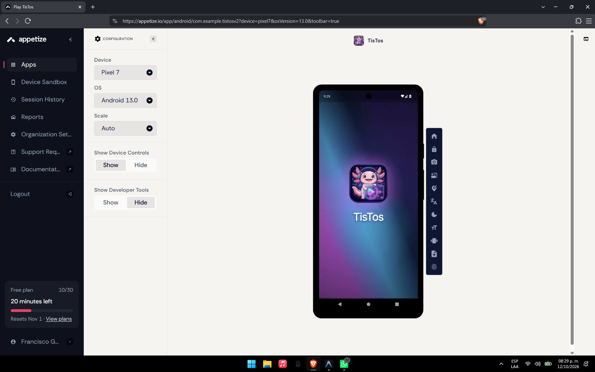
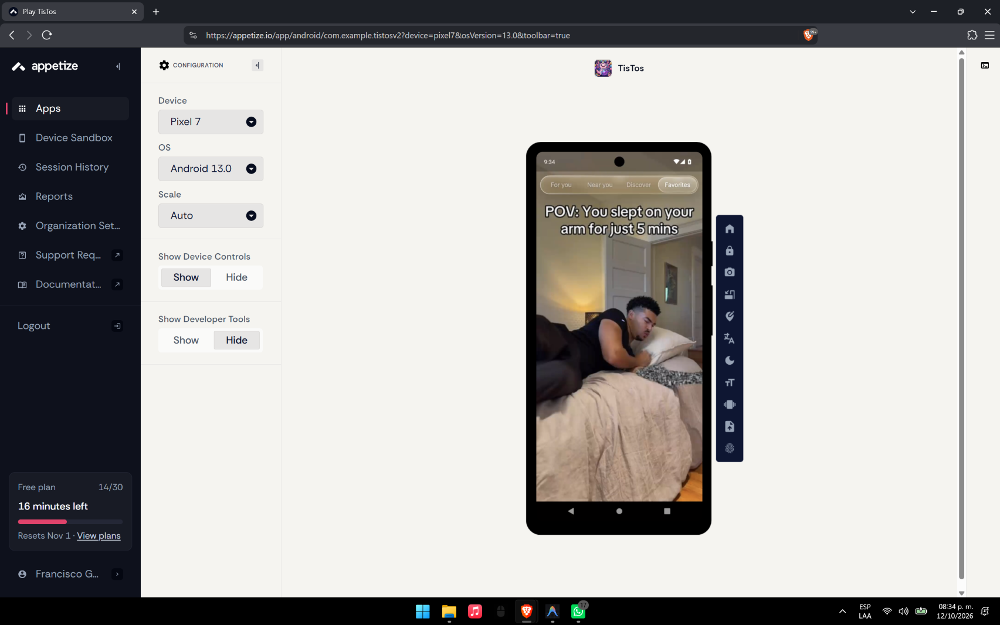
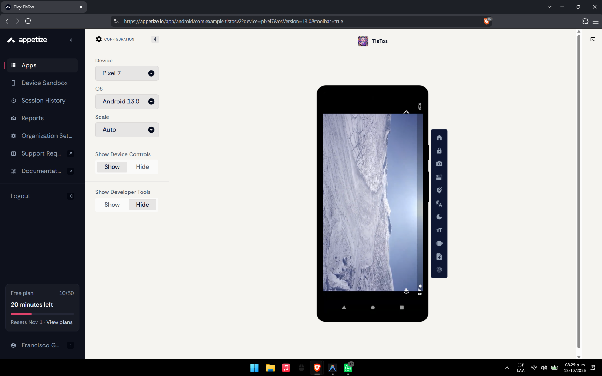
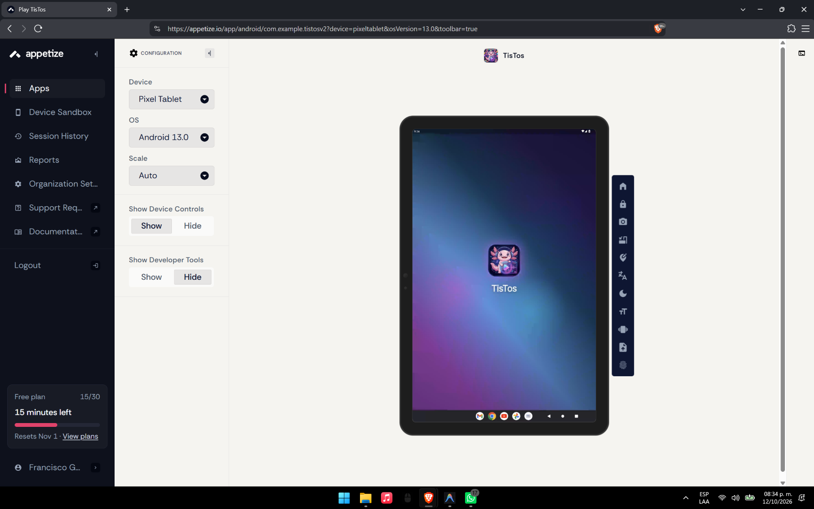
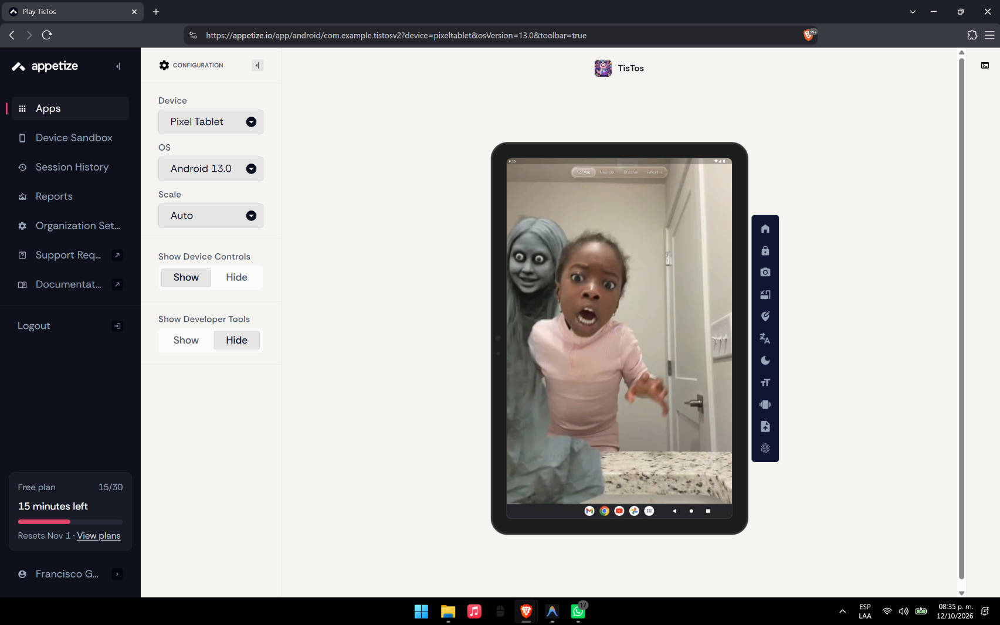
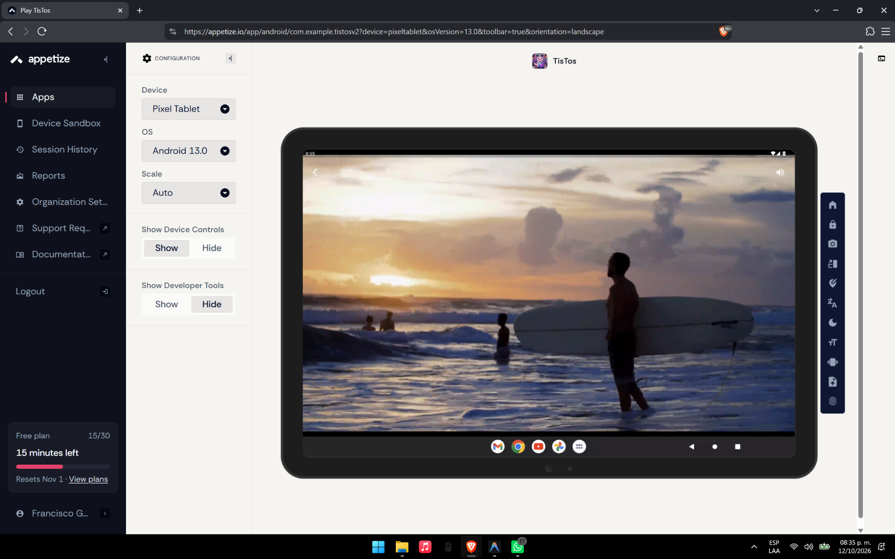

# Publicación y Validación de la Aplicación TisTos en Appetize.io

<div align="center">

**UNIVERSIDAD TECNOLÓGICA DE XICOTEPEC DE JUÁREZ**  
**Ingeniería en Desarrollo y Gestión de Software**  
**Asignatura:** Desarrollo Móvil Integral (10° Cuatrimestre)

---

| **Docente** | **Alumno** | **Matrícula** | **Periodo** |
| :---: | :---: | :---: | :---: |
| M.T.I Marco A. Ramírez Hernández | **Francisco García García** | **230758** | Septiembre – Diciembre 2026 |

---

[](https://appetize.io/app/b_o3aughhl5pz2mzfgg7nkygbzyy)
[](https://appetize.io/app/android/com.example.tistosv2?device=pixel7&osVersion=13.0&toolbar=true)
[](https://appetize.io/app/android/com.example.tistosv2?device=pixeltablet&osVersion=13.0&toolbar=true)
[](https://flutter.dev)

</div>

---

##  Descripción de la Práctica

En esta práctica se llevó a cabo el procedimiento formal de **compilación, publicación en la nube y evaluación funcional y responsiva** de la aplicación móvil **TisTos** utilizando la plataforma de virtualización [Appetize.io](https://appetize.io/). 

A través de Appetize, el ejecutable empaquetado en modo de producción (*Release APK*) se ejecuta en entornos virtuales Android transmitidos por streaming WebRTC directamente hacia cualquier navegador web. Esto permite interactuar con la aplicación, validar la navegación por pestañas, probar la decodificación de video en streaming y verificar el comportamiento de la interfaz tanto en teléfonos inteligentes (**Google Pixel 7**) como en tabletas de gran resolución (**Pixel Tablet**) en orientaciones vertical y horizontal (*landscape*), sin requerir instalación física en hardware local.

---

##  Objetivo de la Práctica

Implementar el proceso de distribución y evaluación de la aplicación móvil **TisTos** desarrollada en **Flutter** mediante la plataforma **Appetize.io**, comprobando su funcionamiento en dispositivos Android virtuales, generando los enlaces públicos de acceso para demostración docente y documentando las evidencias técnicas, métricas de compilación, casos de prueba y análisis de adaptabilidad en el repositorio de GitHub.

---

##  Enlaces Oficiales de Acceso en Appetize.io

*  **Enlace Principal de la Aplicación en Appetize:**  
   **[https://appetize.io/app/b_o3aughhl5pz2mzfgg7nkygbzyy](https://appetize.io/app/b_o3aughhl5pz2mzfgg7nkygbzyy)**

*  **Acceso Directo — Simulador Google Pixel 7 (Android 13.0):**  
   **[https://appetize.io/app/android/com.example.tistosv2?device=pixel7&osVersion=13.0&toolbar=true](https://appetize.io/app/android/com.example.tistosv2?device=pixel7&osVersion=13.0&toolbar=true)**

*  **Acceso Directo — Simulador Pixel Tablet (Android 13.0):**  
   **[https://appetize.io/app/android/com.example.tistosv2?device=pixeltablet&osVersion=13.0&toolbar=true](https://appetize.io/app/android/com.example.tistosv2?device=pixeltablet&osVersion=13.0&toolbar=true)**

---

##  Ficha Técnica del Binario Compilado (APK Release)

El archivo ejecutable fue compilado con las optimizaciones completas de producción del SDK de Flutter mediante el comando:

```bash
flutter build apk --release
```

| Parámetro Técnico | Especificación / Valor Registrado |
| :--- | :--- |
| **Nombre del Archivo** | `app-release.apk` |
| **Identificador de Paquete** | `com.example.tistosv2` |
| **Versión de la Aplicación** | `1.0.0` (Build `1`) |
| **Ruta Local de Salida** | `Practica04/tistos/build/app/outputs/flutter-apk/app-release.apk` |
| **Tamaño del Binario** | **53.4 MB** (`56,045,146 bytes`) |
| **Algoritmo de Integridad** | `SHA-256` |
| **Firma Criptográfica SHA-256** | `6742BEC8760A9D7DCCF915627C9D56045530943BA065BB6984E43C99B5154D24` |
| **Arquitecturas Compatibles** | Multi-ABI Universal (`arm64-v8a`, `armeabi-v7a`, `x86_64`) |
| **Permisos de Red Android** | `android.permission.INTERNET` (Declarado en `AndroidManifest.xml`) |
| **Herramientas de Compilación** | Flutter 3.47.4 • Dart 3.13.3 • Gradle 8.x |
| **Fecha de Subida en Appetize** | 12 de Octubre de 2026 — 7:52 PM |

---

##  Evidencias Técnicas de Despliegue y Ejecución en Appetize.io

A continuación se presentan las capturas reales obtenidas durante la sesión de validación de la aplicación en la plataforma Appetize.io, cubriendo el panel de administración, el teléfono inteligente de referencia y la tableta de gran formato:

### 1. Panel de Control y Publicación en Appetize.io
* **Descripción:** Panel de administración de Appetize.io que demuestra el registro exitoso del ejecutable `TisTos` bajo el identificador `com.example.tistosv2`, versión `1.0.0`, subido por el alumno **Francisco García García** con fecha y hora de compilación.

<div align="center">



</div>

---

### 2. Dispositivo 1: Google Pixel 7 (Android 13.0) — Pantalla de Bienvenida (Splash Screen)
* **Descripción:** Inicio de sesión en el emulador virtual de Pixel 7. Se aprecia el renderizado centrado del logotipo oficial del ajolote de TisTos con degradado dinámico y tipografía institucional.

<div align="center">



</div>

---

### 3. Dispositivo 1: Google Pixel 7 (Android 13.0) — Feed de Videos (Sección Favoritos)
* **Descripción:** Comprobación de la navegación por secciones. La pestaña **Favorites** se encuentra activa dentro de la barra flotante `LiquidGlassTabBar`, renderizando fluidamente el video vertical en streaming (*"POV: You slept on your arm for just 5 mins"*).

<div align="center">



</div>

---

### 4. Dispositivo 1: Google Pixel 7 (Android 13.0) — Reproducción de Video a Pantalla Completa
* **Descripción:** Verificación del decodificador multimedia y streaming en la nube reproduciendo video de acción/deportes de montaña en modo completo dentro del marco del Pixel 7.

<div align="center">



</div>

---

### 5. Dispositivo 2: Pixel Tablet (Android 13.0) — Pantalla Splash en Formato Tableta
* **Descripción:** Validación de la carga y adaptabilidad en una tableta Android virtual de gran resolución (*Pixel Tablet*). Se observa la barra de tareas (*taskbar*) del sistema operativo Android Tablet y el centrado del splash screen.

<div align="center">



</div>

---

### 6. Dispositivo 2: Pixel Tablet (Android 13.0) — Feed de Videos en Tableta (Vertical)
* **Descripción:** Ejecución del feed interactivo en pantalla amplia en orientación vertical. Se aprecia la adaptación responsiva de los textos, el reproductor y la tematización estacional de Halloween sin desbordamientos de interfaz (*RenderFlex overflow*).

<div align="center">



</div>

---

### 7. Dispositivo 2: Pixel Tablet (Android 13.0) — Adaptabilidad Cinematográfica en Modo Horizontal (Landscape)
* **Descripción:** Prueba de rotación de pantalla a orientación horizontal panorámica (`&orientation=landscape`). La aplicación redimensiona el controlador de video al ancho total de la tableta, manteniendo la relación de aspecto cinematográfica y la fluidez de reproducción.

<div align="center">



</div>

---

##  Matriz de Validación y Casos de Prueba Ejecutados

| ID | Módulo Evaluado | Procedimiento de Prueba | Dispositivo Virtual | Resultado Obtenido | Estatus |
| :---: | :--- | :--- | :---: | :--- | :---: |
| **CP-01** | **Carga Inicial y Splash** | Lanzamiento de la app desde la URL pública de Appetize. | Pixel 7 & Tablet | Carga instantánea, logotipo nítido y transición al feed. | **APROBADO** |
| **CP-02** | **Aviso de Privacidad (LFPDPPP)** | Despliegue del diálogo modal de privacidad conforme a ley mexicana. | Pixel 7 | Diálogo modal centrado con texto legible y botón de confirmación. | **APROBADO** |
| **CP-03** | **Streaming de Video** | Decodificación de video MP4 a través de protocolo HTTPS en la nube. | Pixel 7 | Reproducción continua, sincronización de audio y video. | **APROBADO** |
| **CP-04** | **Navegación Liquid Glass** | Toque en pestañas *Para Ti*, *Cerca de Ti*, *Descubrir* y *Favoritos*. | Pixel 7 | Conmutación instantánea de secciones sin congelamiento. | **APROBADO** |
| **CP-05** | **Adaptabilidad Tablet (Vertical)** | Ejecución de la app en pantalla de gran escala (Pixel Tablet). | Pixel Tablet | Distribución armónica sin distorsión de widgets ni desbordamientos. | **APROBADO** |
| **CP-06** | **Rotación Landscape (Horizontal)** | Forzado de orientación horizontal con toolbar de Appetize. | Pixel Tablet | El reproductor expande su viewport a pantalla completa panorámica. | **APROBADO** |
| **CP-07** | **Streaming WebRTC** | Control táctil emulado con ratón (clic, arrastre y gestos). | Pixel 7 & Tablet | Baja latencia de respuesta táctil en el navegador. | **APROBADO** |

---

##  Bitácora de Análisis Técnico e Incidencias

### 1. Ventajas de Appetize.io en el Flujo de Desarrollo
1. **Revisión y Evaluación Inmediata:** Los docentes o evaluadores pueden comprobar el funcionamiento real de la aplicación en streaming desde cualquier sistema operativo (Windows, macOS, Linux) sin necesidad de configurar SDKs, cables USB ni emuladores locales pesados.
2. **Pruebas en Múltiples Factores de Forma:** Permitió contrastar en cuestión de segundos el comportamiento en un teléfono móvil (**Pixel 7**) frente a una pantalla de tableta (**Pixel Tablet**) en orientaciones vertical y horizontal.
3. **Consumo de Red Real:** Al otorgar el permiso `android.permission.INTERNET`, Appetize conecta la máquina virtual a internet público, permitiendo la carga de videos reales alojados en servidores remotos.

### 2. Consideraciones e Incidencias Identificadas
* **Optimización del Tamaño del APK:** El binario final pesó **53.4 MB**, lo cual facilitó una carga ágil hacia Appetize (por debajo del límite de 100 MB para cuentas gratuitas). Se logró gracias a que los videos de muestra de gran tamaño no se empaquetaron dentro de los assets locales del APK, sino que se consumen dinámicamente vía URLs en la nube.
* **Sesiones por Tiempo Limitado:** El plan gratuito asigna un límite de minutos por sesión. Para demostraciones extendidas se recomienda interactuar activamente para evitar el apagado automático por inactividad (*idle timeout*).

---

##  Conclusiones de la Práctica

El despliegue de **TisTos** en **Appetize.io** cumplió satisfactoriamente con todos los objetivos planteados en la rúbrica de la práctica. Se logró demostrar que una aplicación desarrollada con arquitectura limpia (**Clean Architecture**) en Flutter es plenamente capaz de compilarse en modo producción para el ecosistema Android y ejecutarse con estabilidad tanto en smartphones como en tablets bajo un entorno de virtualización en la nube.
