# Práctica 05: Ridgets App — Catálogo Interactivo de Widgets con Material 3, GoRouter y Riverpod

- **Asignatura:** Desarrollo Móvil Integral (10° Cuatrimestre)
- **Carrera:** Ingeniería en Desarrollo y Gestión de Software
- **Docente:** M.T.I. Marco Antonio Ramírez Hernández
- **Alumno:** Francisco García García
- **Matrícula:** 230758
- **Periodo:** Septiembre - Diciembre 2026
- **Valor:** 40 Firmas

---

## Objetivo de la Práctica

Diseñar, estructurar y desarrollar una aplicación móvil multiplataforma en **Flutter** denominada **Ridgets App**, cuyo propósito es fungir como un catálogo interactivo y demostrativo de componentes visuales bajo las directrices de **Material Design 3**, integrando navegación declarativa mediante **GoRouter**, administración de estado reactiva global con **Riverpod** (`StateProvider` y `StateNotifierProvider`), persistencia local en disco con **SharedPreferences** y un sistema avanzado de **8 temas visuales, 8 splash screens y conmutación dinámica del ícono de lanzador nativo** en Android sin cerrar la aplicación.

El proyecto consolida los siguientes conceptos clave de desarrollo móvil:
- **Gestión de Estado con Riverpod:** Implementación de `Provider`, `StateProvider` y `StateNotifierProvider` (`ThemeNotifier`) para sincronizar el contador reactivo, la paleta de colores y el cambio entre **Modo Claro y Modo Oscuro** tanto en `CounterScreen` como en `ThemeChangerScreen`.
- **Persistencia en Almacenamiento Local (`shared_preferences`):** Guardado persistente del tema de color seleccionado (`kSelectedColorKey`) y del modo oscuro (`kIsDarkmodeKey`). La inicialización se realiza en `main()` de manera previa a `runApp()`, inyectando el estado inicial directamente en el `ProviderScope` para evitar parpadeos visuales al iniciar la app.
- **Sistema de 8 Temas y Cambio Dinámico de Ícono Nativo:** Configuración de 8 logos (`logo.jpg` a `logo8.jpg`) mapeados 1 a 1 a 8 paletas cromáticas. Mediante `MethodChannel` (`com.example.flutter_widgets_app/dynamic_icon`) y 8 etiquetas `<activity-alias>` en `AndroidManifest.xml`, el ícono de la aplicación en el Launcher de Android cambia atómicamente sin cerrar la aplicación en primer plano.
- **8 Splash Screens Dinámicos:** Creación de un `SplashScreen` animado que detecta el tema guardado en disco y renderiza en tiempo real el logotipo correspondiente, la insignia con el nombre del tema y un degradado animado estilo aurora generado con la paleta armónica de ese tema.
- **Navegación Declarativa (`go_router`):** Configuración centralizada de rutas con nombres estáticos, transiciones fluidas desde `SplashScreen` hacia `HomeScreen` y navegación mediante `NavigationDrawer` (`SideMenu`).
- **Catálogo Exhaustivo de Widgets Material 3:** Demostración práctica de botones (`ButtonsScreen`), tarjetas (`CardsScreen`), indicadores de progreso (`ProgressScreen`), notificaciones y modales (`SnackbarScreen`), contenedores animados (`AnimatedScreen`), controles de formulario (`UiControlsScreen`), carrusel introductorio (`AppTutorialScreen`) y listas asíncronas con paginación infinita (`InfiniteScrollScreen`).

---

## Tecnologías y Dependencias Utilizadas

| Dependencia / Herramienta | Versión | Propósito en el Proyecto |
| :--- | :---: | :--- |
| **Flutter SDK** | `^3.13.3` | Framework multiplataforma para construcción de interfaces compiladas nativamente. |
| **Dart SDK** | `^3.13.3` | Lenguaje de programación orientado a objetos con tipado estático y nulabilidad segura. |
| **flutter_riverpod** | `^3.4.3` | Gestor de estado reactivo e inyección de dependencias (`ProviderScope`, `ConsumerWidget`, `StateNotifier`). |
| **shared_preferences** | `^2.5.6` | Almacenamiento local persistente en disco para guardar el tema e ícono seleccionado. |
| **MethodChannel & activity-alias** | Nativo Android | Comunicación bidireccional Flutter-Android para conmutar dinámicamente entre 8 íconos de launcher. |
| **go_router** | `^18.0.2` | Enrutador declarativo basado en URLs para navegación profunda y reemplazo de pila (`context.go`, `context.push`). |
| **animate_do** | `^5.1.0` | Biblioteca de animaciones declarativas (`FadeInRight`, `FadeIn`, `SpinPerfect`). |
| **flutter_launcher_icons** | `^0.14.4` | Generación automatizada de densidades mipmap para Android (`ic_launcher_theme_0` a `7`). |
| **Material Design 3** | Nativo | Sistema de diseño moderno activado con `useMaterial3: true` y `colorSchemeSeed`. |
| **Archify** | `2.17.0` | Generación de diagramas interactivos de arquitectura en HTML/SVG con soporte Claro/Oscuro. |

---

## Mapeo de los 8 Temas, Íconos y Splash Screens

| Índice | Nombre del Tema | Color Semilla | Recurso Gráfico | Alias Nativo de Android |
| :---: | :--- | :---: | :---: | :--- |
| **0** | **Azul Clásico** | `Colors.blue` (`#2196F3`) | `assets/images/logo.jpg` | `MainActivityTheme0` |
| **1** | **Verde Azulado (Teal)** | `Colors.teal` (`#009688`) | `assets/images/logo2.jpg` | `MainActivityTheme1` |
| **2** | **Verde Esmeralda** | `Colors.green` (`#4CAF50`) | `assets/images/logo3.jpg` | `MainActivityTheme2` |
| **3** | **Púrpura Vibrante** | `Colors.purple` (`#9C27B0`) | `assets/images/logo4.jpg` | `MainActivityTheme3` |
| **4** | **Púrpura Profundo** | `Colors.deepPurple` (`#673AB7`) | `assets/images/logo5.jpg` | `MainActivityTheme4` |
| **5** | **Naranja Cálido** | `Colors.orange` (`#FF9800`) | `assets/images/logo6.jpg` | `MainActivityTheme5` |
| **6** | **Rosa Suave** | `Colors.pink` (`#E91E63`) | `assets/images/logo7.jpg` | `MainActivityTheme6` |
| **7** | **Rosa Neón (Accent)** | `Colors.pinkAccent` (`#FF4081`) | `assets/images/logo8.jpg` | `MainActivityTheme7` |

---

## Guía de Instalación y Ejecución

### Requisitos Previos
1. **Flutter SDK** configurado en el `PATH` del sistema (`flutter doctor` sin errores).
2. Emulador Android (API 21+) o dispositivo físico con depuración USB activa.

### Pasos de Despliegue

1. **Clonar el repositorio:**
   ```bash
   git clone https://github.com/F-Anks/10A_DMI_230758.git
   ```

2. **Navegar al directorio de la práctica:**
   ```bash
   cd 10A_DMI_230758/Practica05/flutter_widgets_app
   ```

3. **Instalar las dependencias:**
   ```bash
   flutter pub get
   ```

4. **Ejecutar la aplicación en el emulador o dispositivo conectado:**
   ```bash
   flutter run
   ```

---

## Arquitectura del Proyecto

El código fuente sigue una estructura modular organizada en capas de configuración (`config`) y presentación (`presentation`):

```
📦 flutter_widgets_app/
├── 📂 assets/
│   └── 📂 images/                             ← Recursos gráficos (logo.jpg a logo8.jpg) y capturas de evidencia
│
├── 📂 architecture/                           ← Diagramas interactivos generados con Archify
│
├── 📂 lib/
│   ├── 📂 config/                             ← Configuración transversal de la aplicación
│   │   ├── 📂 helpers/
│   │   │   └── 📄 dynamic_icon_helper.dart    ← Canal MethodChannel para invocar cambio de alias en Android
│   │   ├── 📂 menu/
│   │   │   └── 📄 menu_items.dart             ← Definición inmutable de opciones de navegación (MenuItem)
│   │   ├── 📂 router/
│   │   │   └── 📄 app_router.dart             ← Configuración de GoRouter (12 rutas, inicio en /splash)
│   │   └── 📂 theme/
│   │       └── 📄 app_theme.dart              ← Clase AppTheme con paleta de 8 colores, nombres y getLogoPath
│   │
│   ├── 📂 presentation/                       ← Capa de Presentación (UI, Widgets y Estado con Riverpod)
│   │   ├── 📂 providers/
│   │   │   ├── 📄 counter_provider.dart       ← StateProvider<int> para el contador reactivo
│   │   │   └── 📄 theme_provider.dart         ← ThemeNotifier con persistencia local en SharedPreferences
│   │   ├── 📂 screens/
│   │   │   ├── 📂 splash/
│   │   │   │   └── 📄 splash_screen.dart      ← Splash dinámico según el tema activo con degradado aurora y logo
│   │   │   ├── 📂 home/
│   │   │   │   └── 📄 home_screen.dart        ← Pantalla principal con listado de secciones y Drawer
│   │   │   ├── 📂 counter/
│   │   │   │   └── 📄 counter_screen.dart     ← Contador Riverpod con conmutador de Modo Oscuro / Claro
│   │   │   ├── 📂 buttons/
│   │   │   │   └── 📄 buttons_screen.dart     ← Demostración de variantes de botones Material 3 y botón personalizado
│   │   │   ├── 📂 cards/
│   │   │   │   └── 📄 cards_screen.dart       ← Tarjetas con elevación, bordes, relleno e imágenes de red
│   │   │   ├── 📂 progress/
│   │   │   │   └── 📄 progress_screen.dart    ← Indicadores de progreso circulares/lineales controlados por Stream
│   │   │   ├── 📂 snackbar/
│   │   │   │   └── 📄 snackbar_screen.dart    ← Snackbars personalizados y diálogos modales de licencias/alerta
│   │   │   ├── 📂 animated/
│   │   │   │   └── 📄 animated_screen.dart    ← AnimatedContainer con geometría, color y bordes aleatorios
│   │   │   ├── 📂 ui_controls/
│   │   │   │   └── 📄 ui_controls_screen.dart ← SwitchListTile, ExpansionTile, RadioListTile y CheckboxListTile
│   │   │   ├── 📂 app_tutorial/
│   │   │   │   └── 📄 app_tutorial_screen.dart← PageView introductorio con detección de última página
│   │   │   ├── 📂 infinite_scroll/
│   │   │   │   └── 📄 infinite_scroll_screen.dart ← Paginación asíncrona con Picsum Photos y Pull to Refresh
│   │   │   ├── 📂 theme_changer/
│   │   │   │   └── 📄 theme_changer_screen.dart   ← Selector interactivo con miniaturas de logo, feedback y RadioListTile
│   │   │   └── 📄 screens.dart                ← Archivo barril (barrel file) de exportación de pantallas
│   │   └── 📂 widgets/
│   │       └── 📄 side_menu.dart              ← NavigationDrawer adaptable a notch con secciones divididas
│   │
│   └── 📄 main.dart                           ← Inicialización síncrona de SharedPreferences y ProviderScope
│
└── 📄 pubspec.yaml                            ← Manifiesto de dependencias, assets y configuración de íconos
```

---

## Diagrama de Arquitectura del Proyecto

Se incluye el diagrama interactivo de la arquitectura generado con **Archify**, ilustrando el flujo entre dependencias, proveedores de Riverpod (`ThemeNotifier` y `counterProvider`), enrutamiento con `GoRouter` y las pantallas de presentación:

- **[Ver Diagrama en Vivo (GitHub Pages)](https://f-anks.github.io/10A_DMI_230758/Practica05/flutter_widgets_app/architecture/flutter_widgets_app-architecture.html)**
- **[Archivo Local HTML](architecture/flutter_widgets_app-architecture.html)** | **[Esquema JSON](architecture/flutter_widgets_app.architecture.json)**

| Modo Oscuro | Modo Claro |
| :---: | :---: |
| 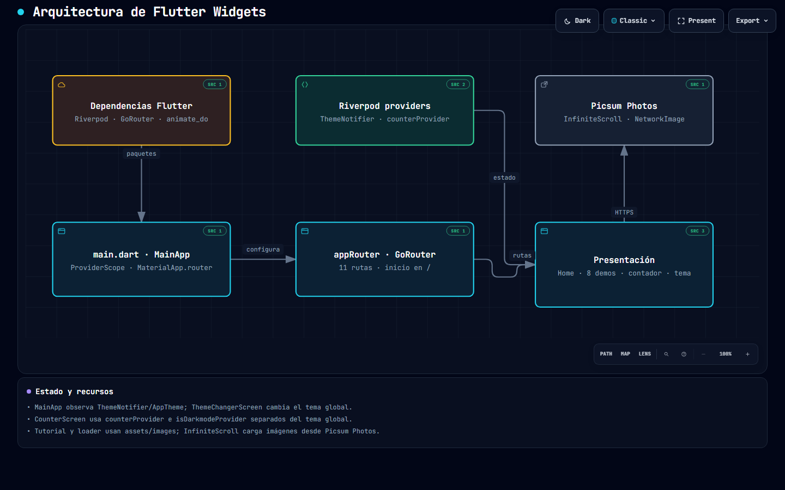 | 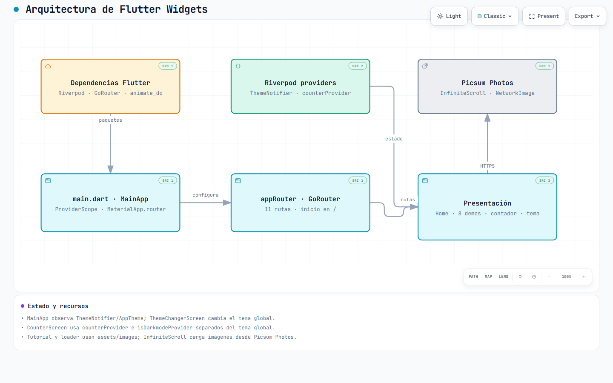 |

---

## Evidencias Visuales y Secciones Implementadas

### 1. Sistema Dinámico de 8 Splash Screens, Íconos y Almacenamiento Local
Se implementó un sistema integral donde cada tema cuenta con su propio logotipo (`logo.jpg` a `logo8.jpg`), degradado aurora dinámico y cambio atómico de ícono de lanzador nativo. Al cambiar de tema, la preferencia se persiste inmediatamente en `shared_preferences` y el nuevo ícono queda reflejado en el sistema operativo sin cerrar la app. Al reabrirla, se despliega el Splash correspondiente.

| Splash Tema Azul (Por Defecto) | Splash Tema Naranja (Guardado) | Selector de Temas con Logos | Ícono Dinámico en el Sistema |
| :---: | :---: | :---: | :---: |
| 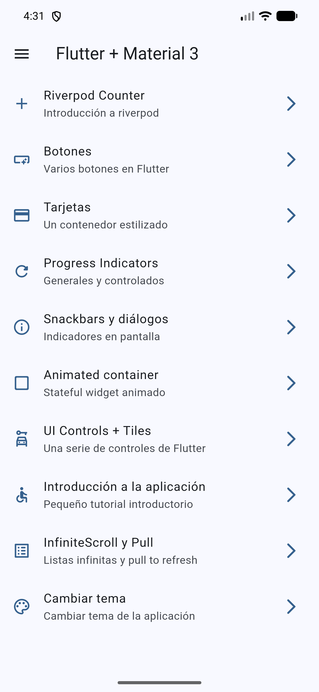 | 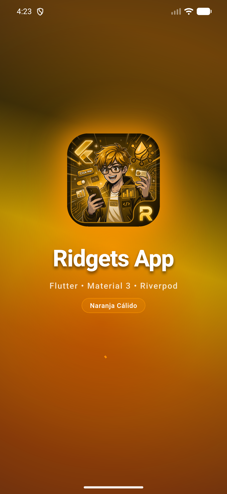 | 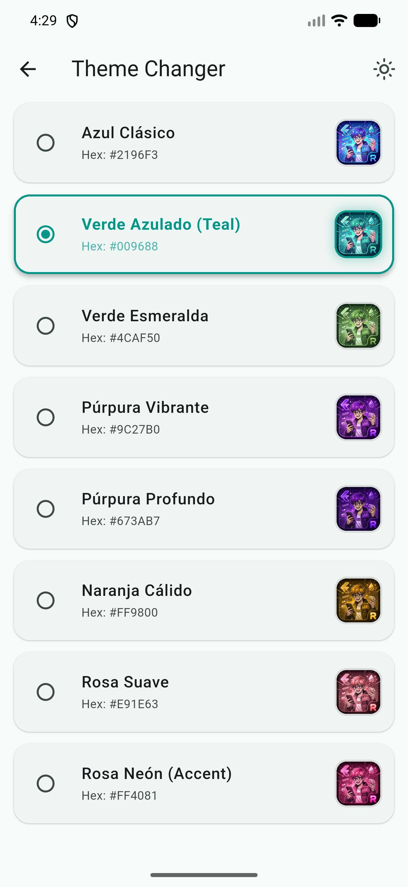 | 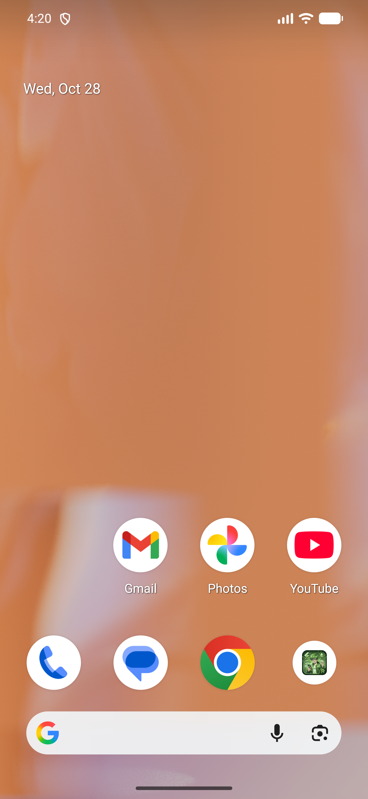 |

---

### 2. Pantalla Principal (`HomeScreen`) y Menú Lateral (`SideMenu`)
Listado principal de secciones construido a partir de `appMenuItems` y menú de navegación lateral (`NavigationDrawer`) con soporte de *safe area* y *notch*.

| Pantalla Principal (`HomeScreen`) | Menú Lateral (`NavigationDrawer`) |
| :---: | :---: |
| 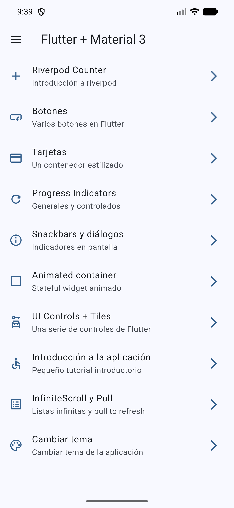 | 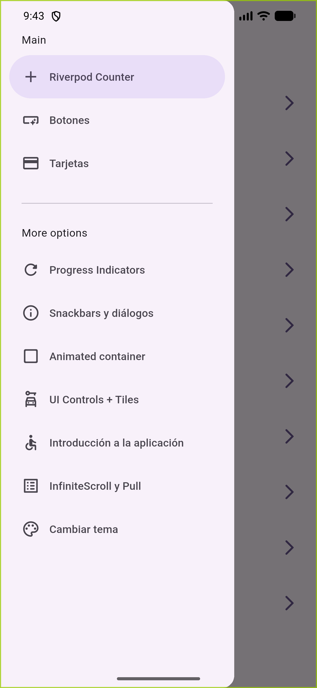 |

---

### 3. Riverpod Counter (Modo Claro y Modo Oscuro Sincronizados)
Gestión del contador mediante `counterProvider` y sincronización del botón de **Modo Oscuro / Modo Claro** en el `AppBar` conectándolo directamente a `themeNotifierProvider` (`ref.read(themeNotifierProvider.notifier).toggleDarkmode()`), permitiendo alternar el tema global de toda la aplicación desde esta pantalla al igual que en la sección *Cambiar tema*.

| Riverpod Counter — Modo Claro | Riverpod Counter — Modo Oscuro |
| :---: | :---: |
| 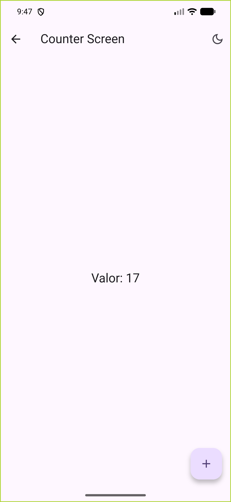 | 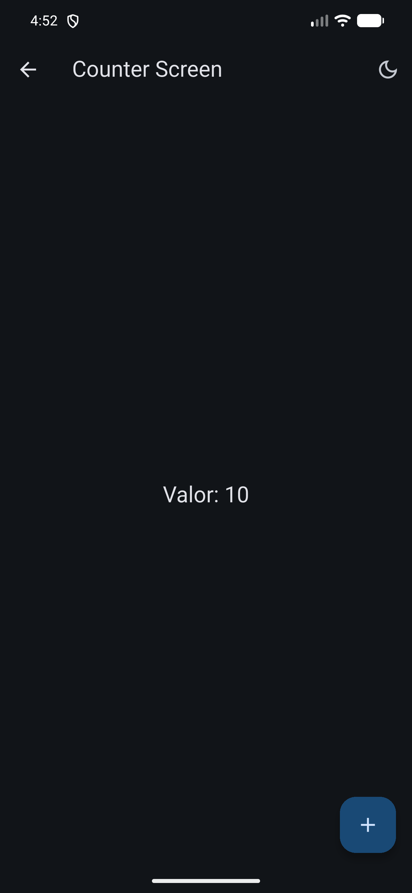 |

---

### 4. Botones (`ButtonsScreen`) y Tarjetas (`CardsScreen`)
Catálogo de botones de Material 3 (`ElevatedButton`, `FilledButton`, `OutlinedButton`, `TextButton`, `IconButton` y un botón personalizado con `InkWell`) y tarjetas con distintas configuraciones de elevación, bordes y fotografías cargadas desde red.

| Variantes de Botones | Tarjetas Estilizadas |
| :---: | :---: |
| 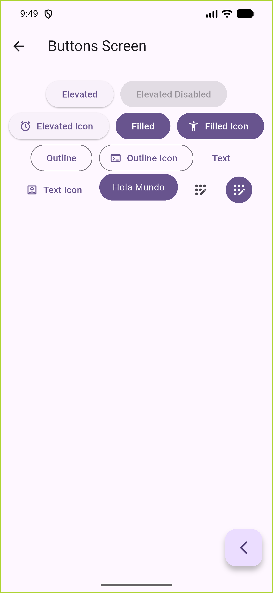 | 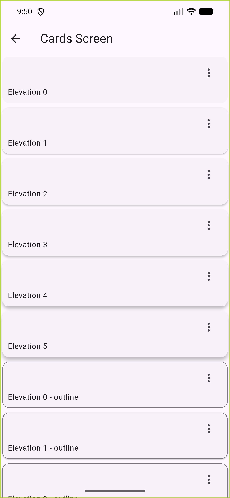 |

---

### 5. Indicadores de Progreso (`ProgressScreen`) y Snackbars / Diálogos (`SnackbarScreen`)
Indicadores de progreso indeterminados y controlados en tiempo real mediante `StreamBuilder`, junto con visualización de `SnackBar` y cuadros de diálogo modales (`AlertDialog` y `showAboutDialog`).

| Progress Indicators | Snackbars y Diálogos |
| :---: | :---: |
| 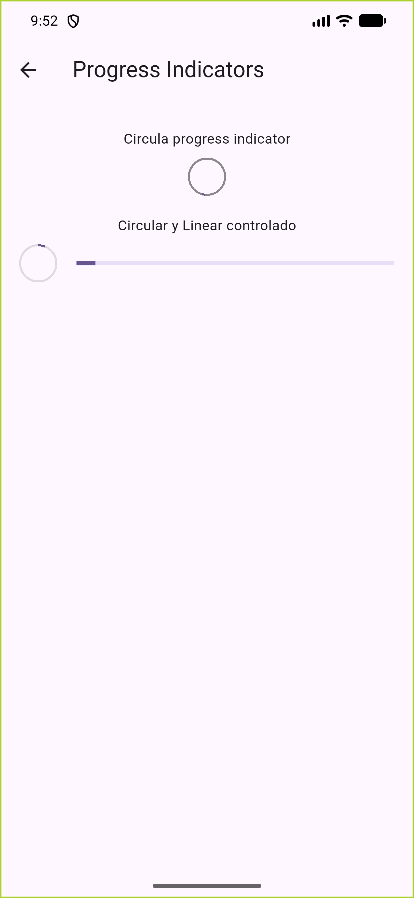 | 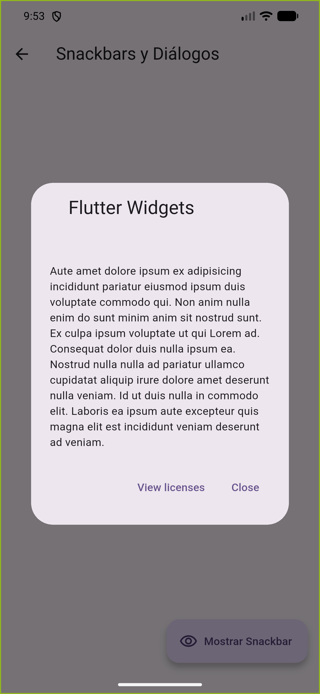 |

---

### 6. Contenedor Animado (`AnimatedScreen`) y Controles de UI (`UiControlsScreen`)
Transiciones implícitas suaves con `AnimatedContainer` (dimensiones, radio de bordes y color aleatorios usando `Curves.elasticOut`) y controles interactivos de selección (`SwitchListTile`, `ExpansionTile`, `RadioListTile` y `CheckboxListTile`).

| Animated Container | UI Controls + Tiles |
| :---: | :---: |
| 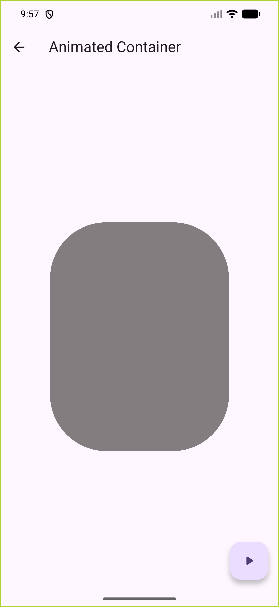 | 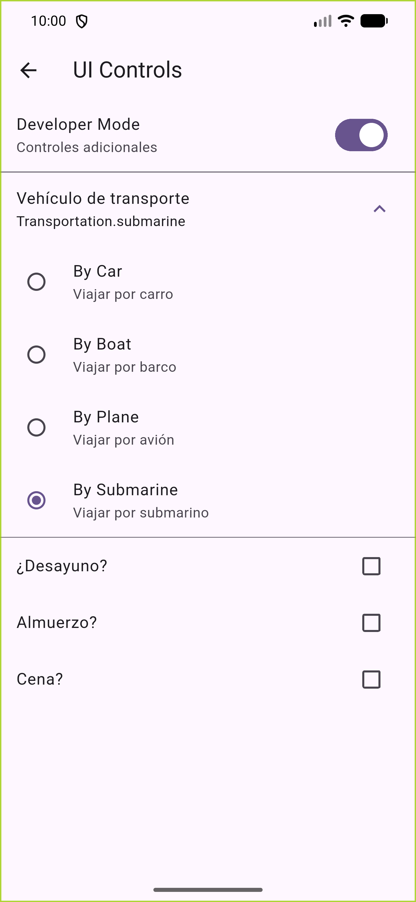 |

---

### 7. Tutorial Introductorio (`AppTutorialScreen`), Infinite Scroll (`InfiniteScrollScreen`) y Selector de Tema (`ThemeChangerScreen`)
Carrusel de bienvenida con `PageView` y animación `FadeInRight`, lista infinita con carga diferida (`FadeInImage`) y `RefreshIndicator`, y pantalla de personalización del tema global (`ThemeChangerScreen`) con retroalimentación inmediata mediante `SnackBar`.

| Introducción a la Aplicación | InfiniteScroll y Pull to Refresh | Confirmación de Cambio de Tema |
| :---: | :---: | :---: |
| 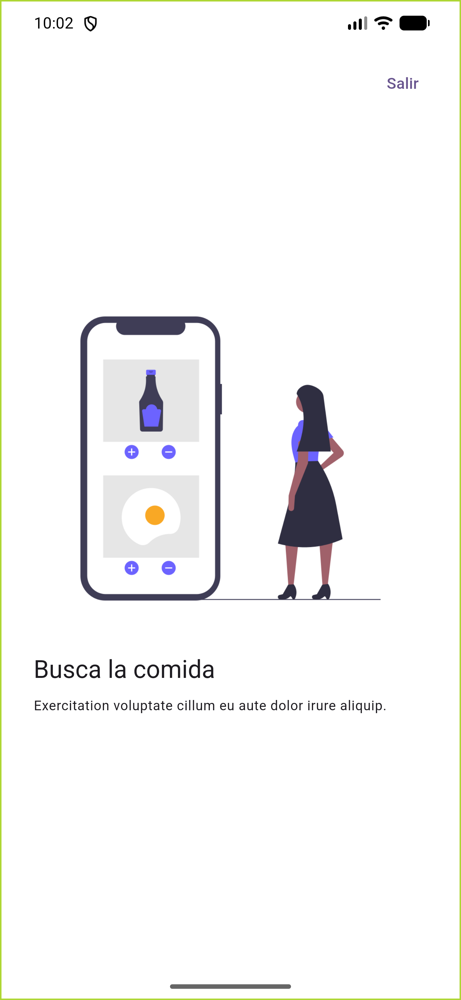 |  | 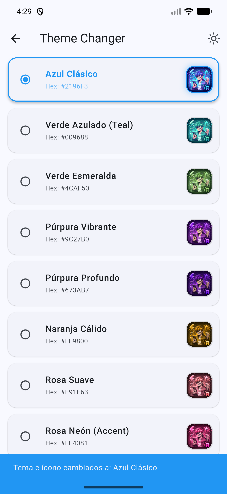 |

---

## Conclusiones Técnicas

1. **Persistencia Local Robusta con SharedPreferences:** La carga previa de las preferencias en `main()` antes de inflar la jerarquía de widgets garantizó que `SplashScreen` y `MaterialApp` conozcan el estado exacto de color y modo oscuro desde el primer fotograma (fotograma 0), erradicando parpadeos o cambios abruptos de tema en el arranque en frío.
2. **Conmutación Dinámica de Íconos Nativos sin Interrupción:** Al aprovechar la arquitectura de múltiples `<activity-alias>` en Android junto con la delegación atómica en `onStop()`, se resolvió la limitación del sistema operativo que fuerza el cierre de la aplicación si se desactiva un alias en primer plano. El usuario disfruta de un cambio visual instantáneo dentro de Flutter y un reemplazo limpio en el lanzador del sistema al salir.
3. **Escalabilidad Visual con Sistema Multi-Splash:** La modularización de las paletas y logos (`logo.jpg` a `logo8.jpg`) dentro de `app_theme.dart` y `splash_screen.dart` demuestra la potencia del diseño declarativo en Flutter, transformando una pantalla de bienvenida estática en un componente dinámico reactivo al estado del usuario.
