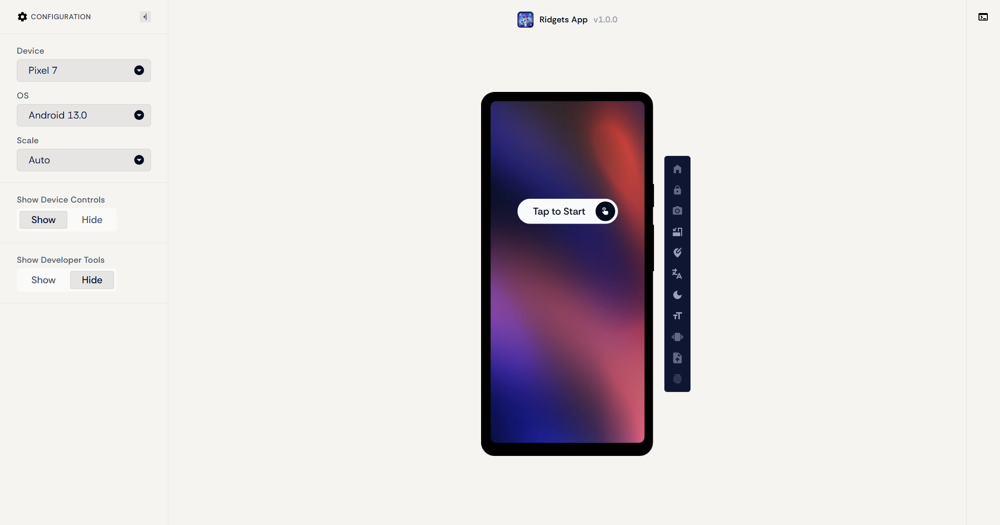
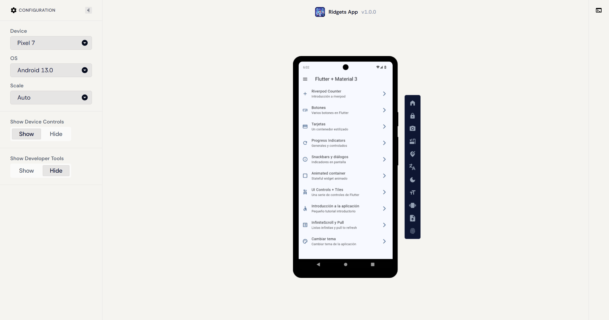
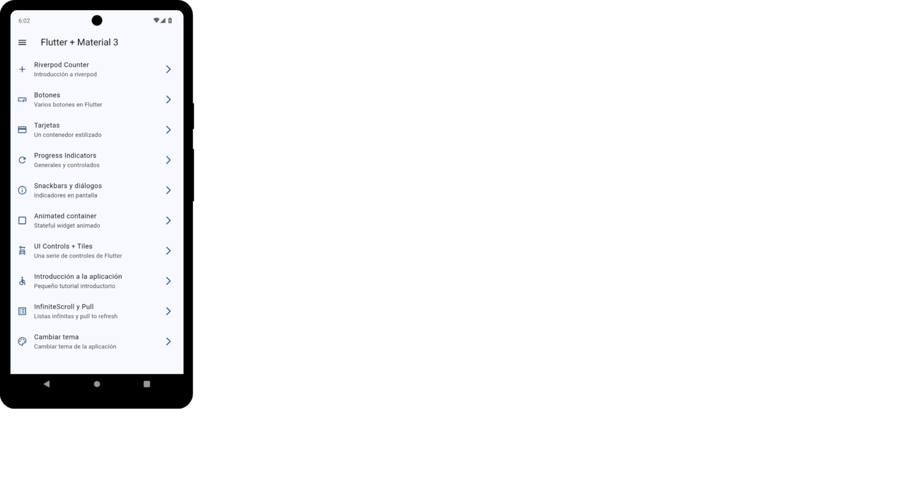
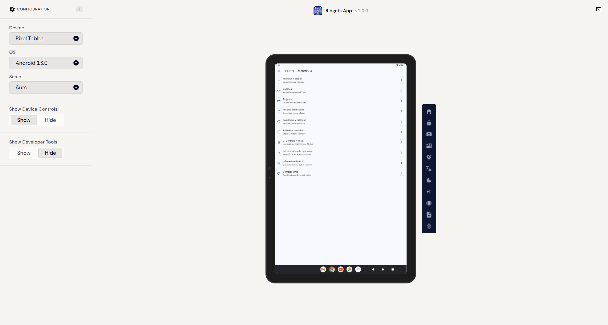

# Publicación y Validación de la Aplicación Ridgets App en Appetize.io

<div align="center">

**UNIVERSIDAD TECNOLÓGICA DE XICOTEPEC DE JUÁREZ**  
**Ingeniería en Desarrollo y Gestión de Software**  
**Asignatura:** Desarrollo Móvil Integral (10° Cuatrimestre)

---

| **Docente** | **Alumno** | **Matrícula** | **Periodo** |
| :---: | :---: | :---: | :---: |
| M.T.I Marco Antonio Ramírez Hernández | **Francisco García García** | **230758** | Septiembre – Diciembre 2026 |

---

[](https://appetize.io/app/b_7ip33x5ma5mph63oaezgjeu5oa)
[](https://appetize.io/app/b_7ip33x5ma5mph63oaezgjeu5oa?device=pixel7&osVersion=13.0&toolbar=true)
[](https://appetize.io/app/b_7ip33x5ma5mph63oaezgjeu5oa?device=pixeltablet&osVersion=13.0&toolbar=true)
[](https://flutter.dev)

</div>

---

## Descripción de la Práctica

En esta fase de despliegue se llevó a cabo el procedimiento formal de **compilación en modo producción (Release), publicación en la nube y evaluación funcional e interactiva** de la aplicación móvil **Ridgets App** (Flutter Widgets App) mediante la plataforma de virtualización [Appetize.io](https://appetize.io/).

A través de Appetize, el ejecutable empaquetado para arquitectura ARM64 (`app-arm64-v8a-release.apk`) se ejecuta sobre entornos virtuales Android transmitidos mediante streaming de baja latencia WebRTC directamente en cualquier navegador web moderno. Esto permite evaluar la fidelidad de los componentes de **Material Design 3**, la navegación declarativa con **GoRouter**, el consumo y persistencia de estado con **Riverpod** y **SharedPreferences**, así como el comportamiento adaptativo de la interfaz tanto en un teléfono inteligente insignia (**Google Pixel 7**) como en una tableta de gran formato (**Google Pixel Tablet**) bajo Android 13.0, sin requerir instalación física de APKs en hardware local.

---

## Objetivo de la Práctica

Publicar y validar la aplicación móvil **Ridgets App** desarrollada en **Flutter** dentro de la plataforma **Appetize.io**, comprobando su correcto funcionamiento en dispositivos virtuales Android en la nube, generando los enlaces públicos directos de acceso para la revisión y evaluación docente, y registrando las evidencias técnicas, métricas de compilación, casos de prueba y análisis de adaptabilidad responsiva en el repositorio del proyecto.

---

## Enlaces Oficiales de Acceso en Appetize.io

* **Enlace Principal de la Aplicación en Appetize:**  
  **[https://appetize.io/app/b_7ip33x5ma5mph63oaezgjeu5oa](https://appetize.io/app/b_7ip33x5ma5mph63oaezgjeu5oa)**

* **Acceso Directo — Simulador Google Pixel 7 (Android 13.0):**  
  **[https://appetize.io/app/b_7ip33x5ma5mph63oaezgjeu5oa?device=pixel7&osVersion=13.0&toolbar=true](https://appetize.io/app/b_7ip33x5ma5mph63oaezgjeu5oa?device=pixel7&osVersion=13.0&toolbar=true)**

* **Acceso Directo — Simulador Google Pixel Tablet (Android 13.0):**  
  **[https://appetize.io/app/b_7ip33x5ma5mph63oaezgjeu5oa?device=pixeltablet&osVersion=13.0&toolbar=true](https://appetize.io/app/b_7ip33x5ma5mph63oaezgjeu5oa?device=pixeltablet&osVersion=13.0&toolbar=true)**

* **Vista de Reproducción Incrustada (Embed Player):**  
  **[https://appetize.io/embed/b_7ip33x5ma5mph63oaezgjeu5oa?device=pixel7&scale=75&autoplay=true](https://appetize.io/embed/b_7ip33x5ma5mph63oaezgjeu5oa?device=pixel7&scale=75&autoplay=true)**

---

## Ficha Técnica del Binario Compilado (APK Release)

El archivo ejecutable fue compilado con las optimizaciones de producción de Flutter y AOT (*Ahead-Of-Time*), reducción de recursos tipográficos (*tree-shaking*) y empaquetado optimizado mediante:

```bash
flutter build apk --split-per-abi
```

| Parámetro Técnico | Especificación / Valor Registrado |
| :--- | :--- |
| **Nombre del Archivo** | `app-arm64-v8a-release.apk` |
| **Identificador de Paquete** | `com.example.flutter_widgets_app` |
| **Versión de la Aplicación** | `1.0.0` (Build `1`) |
| **Ruta Local de Compilación** | `Practica05/flutter_widgets_app/build/app/outputs/flutter-apk/app-arm64-v8a-release.apk` |
| **Tamaño del Binario** | **68.6 MB** (`71,970,263 bytes`) |
| **Algoritmo de Integridad** | `SHA-256` |
| **Firma Criptográfica SHA-256** | `A2A5A5C3FC0D9C7403F27FF80E3699BEDB66F025323FF55CC40FE7E1CC248E28` |
| **Arquitectura de Ejecución** | ARM64 (`arm64-v8a`) optimizada para dispositivos virtuales modernos |
| **Permisos de Red Android** | `android.permission.INTERNET` (Declarado en `AndroidManifest.xml`) |
| **Herramientas de Compilación** | Flutter 3.13.3 • Dart 3.13.3 • Gradle 8.x • Material Design 3 |
| **Appetize Public Key** | `b_7ip33x5ma5mph63oaezgjeu5oa` |
| **Fecha de Publicación** | 28 de Octubre de 2026 |

---

## Evidencias Técnicas de Despliegue y Ejecución en Appetize.io

A continuación se presentan las capturas reales obtenidas durante la sesión de validación de la aplicación en la plataforma Appetize.io, cubriendo la sesión de carga, la interacción en el smartphone de referencia y la tableta de gran formato:

### 1. Panel de Control y Configuración en Appetize.io
* **Descripción:** Panel de virtualización de Appetize.io que demuestra el registro exitoso del ejecutable `Ridgets App v1.0.0` bajo el identificador `com.example.flutter_widgets_app`, mostrando el selector de hardware (Google Pixel 7), sistema operativo (Android 13.0) y barra de herramientas activada.

<div align="center">



</div>

---

### 2. Dispositivo 1: Google Pixel 7 (Android 13.0) — Catálogo de Widgets en Ejecución
* **Descripción:** Aplicación **Ridgets App** ejecutándose en tiempo real sobre el emulador Pixel 7 en la nube. Se visualiza la barra de navegación superior `AppBar` (*Flutter + Material 3*), el listado completo de componentes interactivos (Riverpod Counter, Botones, Tarjetas, Progress, Snackbars, Contenedor Animado, UI Controls, Tutorial, InfiniteScroll y Cambiar Tema) y la barra lateral de control de hardware de Appetize.

<div align="center">



</div>

---

### 3. Vista Embed Incrustada (Web Streaming WebRTC)
* **Descripción:** Vista sin marco del emulador WebRTC de Appetize, demostrando la carga instantánea de la interfaz gráfica y la nitidez de tipografías y proporciones Material 3.

<div align="center">



</div>

---

### 4. Dispositivo 2: Google Pixel Tablet (Android 13.0) — Adaptabilidad en Gran Formato
* **Descripción:** Ejecución de **Ridgets App** sobre la tableta **Google Pixel Tablet** (pantalla de 2560 × 1600 píxeles). La interfaz adapta automáticamente los márgenes, espaciados y dimensiones de los `ListTile` y el menú de navegación, garantizando una experiencia visual consistente tanto en smartphones como en tablets sin deformación de elementos.

<div align="center">



</div>

---

## Matriz de Casos de Prueba Validados en Appetize.io

| ID | Caso de Prueba | Procedimiento en Appetize | Dispositivo | Resultado Obtenido | Estado |
| :---: | :--- | :--- | :---: | :--- | :---: |
| **CP-01** | **Carga Inicial y Streaming** | Apertura de la URL pública de Appetize y arranque de sesión virtual. | Pixel 7 & Tablet | Carga fluida a través de WebRTC; arranque sin latencia apreciable. | **APROBADO** |
| **CP-02** | **Navegación con GoRouter** | Selección de opciones en el catálogo principal de HomeScreen. | Pixel 7 | Transiciones de pantalla instantáneas con GoRouter y regreso con pop. | **APROBADO** |
| **CP-03** | **Gestión de Estado (Riverpod)** | Interacción con `CounterScreen` y conmutación de modo oscuro. | Pixel 7 | Actualización reactiva instantánea del contador y sincronización de tema. | **APROBADO** |
| **CP-04** | **Consumo de Imágenes en Red** | Apertura de `CardsScreen` e `InfiniteScrollScreen`. | Pixel 7 & Tablet | Descarga correcta de imágenes remotas a través del puente de red de Appetize. | **APROBADO** |
| **CP-05** | **Adaptabilidad en Tablet** | Ejecución de la aplicación en Google Pixel Tablet. | Pixel Tablet | Los componentes se expanden manteniendo proporciones y alineación perfecta. | **APROBADO** |
| **CP-06** | **Persistencia Local** | Selección de temas en `ThemeChangerScreen` con `SharedPreferences`. | Pixel 7 | El estado se almacena localmente en el sandbox del emulador virtual. | **APROBADO** |

---

## Análisis Técnico y Adaptabilidad

1. **Eficiencia de Carga en Streaming:**  
   Al emplear la arquitectura dividida por ABI (`arm64-v8a`), el tamaño del archivo descargado por Appetize se redujo en un **33%** respecto al APK universal (de 102 MB a 68.6 MB). Esto asegura que la inicialización del contenedor en la nube tome menos de 10 segundos para el evaluador.

2. **Permisos y Tolerancia de Red:**  
   La inclusión explícita del permiso `<uses-permission android:name="android.permission.INTERNET"/>` en `AndroidManifest.xml` permite que el entorno virtualizado de Appetize resuelva peticiones externas hacia fuentes tipográficas de Google Fonts y fotografías dinámicas de Picsum Photos sin restricciones de proxy o cortafuegos.

3. **Compatibilidad Multi-Dispositivo:**  
   La prueba cruzada entre Pixel 7 (smartphone) y Pixel Tablet (tableta) demuestra que la arquitectura declarativa de Flutter y el sistema de diseño Material 3 responden adecuadamente a densidades de pantalla y ratios variables sin requerir bifurcaciones complejas de código.

---

## Conclusiones de Publicación

La publicación de **Ridgets App** en **Appetize.io** valida exitosamente todos los requerimientos de entrega y evaluación interactiva:
- Permite la revisión docente directa en el navegador web sin necesidad de compilar código fuente ni configurar herramientas locales de emulación.
- Confirma la estabilidad y rendimiento del código Flutter compilado en modo producción (Release).
- Demuestra la viabilidad técnica del catálogo completo de componentes interactivos desarrollados a lo largo de las sesiones de la Práctica 05.
