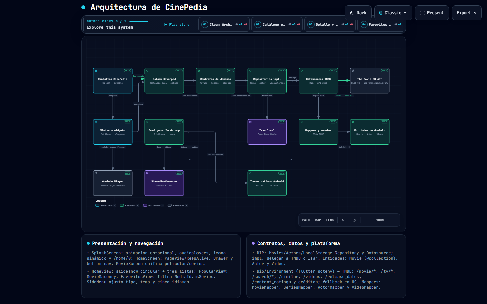
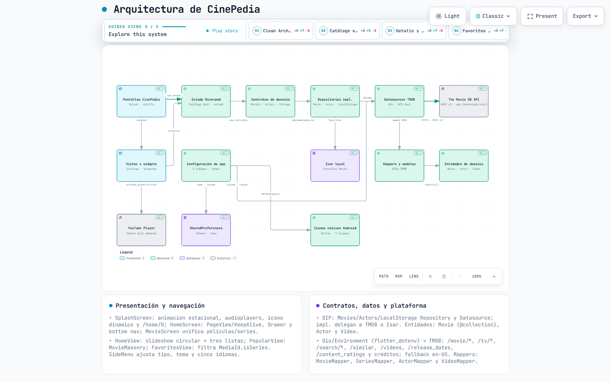
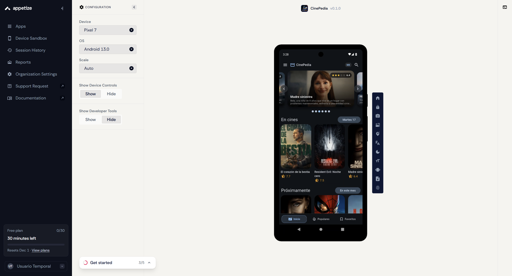
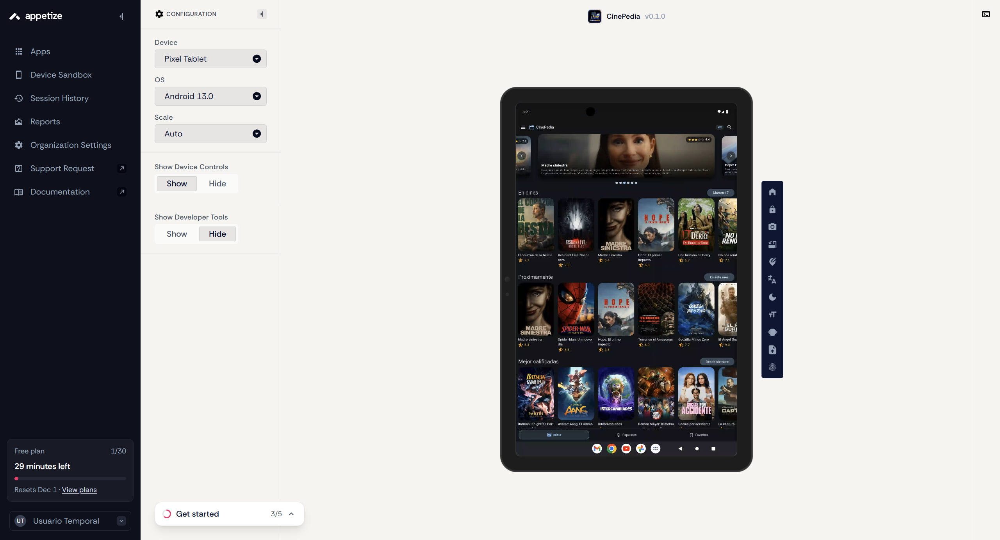

# Práctica 06: CinePedia — Aplicación de Películas y Series con Clean Architecture, Riverpod, Isar y TMDB API

- **Asignatura:** Desarrollo Móvil Integral (10° Cuatrimestre)
- **Carrera:** Ingeniería en Desarrollo y Gestión de Software
- **Docente:** M.T.I. Marco Antonio Ramírez Hernández
- **Alumno:** Francisco García García
- **Matrícula:** 230758
- **Periodo:** Septiembre - Diciembre 2026

<div align="center">

[](https://appetize.io/app/b_ftdb65flgbrrejs7yn7hnguncm)
[](appetize/README.md)
[](https://f-anks.github.io/10A_DMI_230758/Practica06/flutter_cinemapedia/architecture/cinemapedia-architecture.html)

</div>

---

## Objetivo de la Práctica

Diseñar, estructurar y desarrollar **CinePedia**, una aplicación móvil multiplataforma en **Flutter** bajo los principios de **Clean Architecture** e inversión de dependencias, que consume en tiempo real la API REST v3 de **The Movie DB (TMDB)** para ofrecer un catálogo dual de **Películas y Series de TV**, soporte **multilenguaje en 5 idiomas** con respaldo automático en inglés, **clasificación de edad según el país seleccionado**, reproducción de **tráilers de YouTube**, búsqueda con *debounce*, persistencia local de favoritos con **Isar NoSQL**, tematización de interfaz (Modo Oscuro/Claro y 6 paletas por temporada) e **íconos y splash screens dinámicos por fecha**.

El proyecto integra los siguientes pilares técnicos:
- **Clean Architecture & SOLID:** Separación estricta entre `domain` (entidades y contratos abstractos), `infrastructure` (datasources, modelos DTO, mappers e implementaciones de repositorio), `presentation` (providers Riverpod, screens, views, delegates y widgets) y `config` (ruteo, temas, i18n, constantes y helpers).
- **Catálogo Dual (Películas y Series):** Conmutación reactiva entre endpoints `/movie/*` y `/tv/*` reutilizando las vistas, rutas y almacenamiento local mediante codificación sin colisiones (`MediaId` con IDs negativos para series).
- **Internacionalización en 5 Idiomas (`es-MX`, `en-US`, `de-DE`, `zh-CN`, `ar-EG`):** Traducción completa de la interfaz (`AppStrings`), fechas localizadas con `intl`, recarga automática del catálogo TMDB, respaldo a `en-US` cuando una sinopsis o título no está disponible en el idioma elegido (`_withEnglishFallback`) y dirección `TextDirection.ltr` fija para mantener estable el diseño en árabe.
- **Clasificación de Edad por País:** Obtención dinámica desde `/movie/{id}/release_dates` (priorizando estreno teatral `type == 3`) y `/tv/{id}/content_ratings`, formateo `FSK` para Alemania (`DE`), aproximación desde `US` para Egipto (`EG`) y respaldo `NR`.
- **Persistencia Local Híbrida (`Isar` + `SharedPreferences`):** Base de datos NoSQL **Isar** para guardar y paginar películas y series favoritas en disco, y **SharedPreferences** para recordar el idioma activo, el modo oscuro/claro y el color de tema.
- **Personalización Estacional y Temas de Interfaz:** `SplashScreen` animado con audio (`audioplayers`) e ícono de lanzador nativo sincronizado según la fecha mediante `MethodChannel` y 7 `<activity-alias>` en Android, además de un selector en el menú lateral para alternar entre **Modo Oscuro / Claro** y **6 paletas cromáticas de temporada**.

---

## Tecnologías y Dependencias Utilizadas

| Dependencia / Herramienta | Versión | Propósito en el Proyecto |
| :--- | :---: | :--- |
| **Flutter SDK** | `^3.13.3` | Framework multiplataforma para construcción de interfaces nativas con Material 3. |
| **Dart SDK** | `^3.13.3` | Lenguaje tipado con soporte asíncrono (`Future`, `Stream`) y nulabilidad segura. |
| **flutter_riverpod** | `^2.5.1` | Gestión de estado reactiva e inyección de dependencias (`Provider`, `StateProvider`, `StateNotifierProvider`, `FutureProvider.family`). |
| **go_router** | `^14.3.2` | Enrutamiento declarativo con soporte de parámetros (`/splash`, `/home/:page`, `/home/:page/movie/:id`). |
| **dio** | `^5.7.0` | Cliente HTTP para consumo de la API v3 de The Movie DB con parámetros de API key e idioma. |
| **isar** / **isar_flutter_libs** | `3.1.0+1` | Base de datos local NoSQL de alto rendimiento para persistencia de películas y series favoritas. |
| **shared_preferences** | `^2.5.6` | Persistencia clave-valor para recordar idioma (`app_language_api_code`) y tema visual (`app_theme_is_dark`, `app_theme_color_index`). |
| **flutter_localizations** / **intl** | `^0.20.3` | Delegados de localización oficial y formateo de fechas y cifras (`HumanFormats`). |
| **card_swiper** | `^3.0.1` | Carrusel principal con controlador programático, paginación de puntos, flechas laterales y autoplay circular. |
| **flutter_staggered_grid_view** | `^0.7.0` | Cuadrícula tipo *Masonry* de 3 columnas con scroll infinito para Populares y Favoritos. |
| **youtube_player_flutter** | `^10.0.1` | Reproductor embebido de tráilers y videos oficiales desde YouTube. |
| **animate_do** | `^3.3.4` | Micro-animaciones declarativas (`FadeIn`, `FadeInRight`, `SpinPerfect`). |
| **audioplayers** | `^6.8.1` | Reproducción de efectos de sonido estacionales durante el `SplashScreen`. |
| **flutter_dotenv** | `^5.2.1` | Carga de variables de entorno (`.env`) para la llave `THE_MOVIEDB_KEY`. |
| **Archify** | `2.17.0` | Generación del diagrama interactivo de arquitectura en HTML/JSON con soporte Claro/Oscuro. |

---

## Estructura del Proyecto (Clean Architecture)

```text
Practica06/flutter_cinemapedia/
├── android/                                    ← Configuración nativa Android y 7 <activity-alias> en AndroidManifest.xml
├── architecture/                               ← Diagrama interactivo Archify (HTML, JSON y capturas visual-check)
├── appetize/                                   ← Documentación y evidencias de despliegue en Appetize.io
├── assets/
│   ├── images/                                 ← Logos estacionales (normal, navidad, cine, aniversario, halloween, san valentín)
│   ├── loaders/                                ← Indicador animado bottle-loader.gif
│   └── sounds/                                 ← Pistas de audio estacionales para el SplashScreen
├── lib/
│   ├── config/
│   │   ├── constants/                          ← Environment (lectura de THE_MOVIEDB_KEY desde .env)
│   │   ├── helpers/                            ← AgeRatings, DynamicIconHelper, HumanFormats, LogoHelper, MediaId
│   │   ├── i18n/                               ← AppLanguage (5 países) y AppStrings (traducciones UI)
│   │   ├── router/                             ← AppRouter (GoRouter: /splash, /home/:page, movie/:id)
│   │   └── theme/                              ← AppTheme (Modo Oscuro/Claro + 6 colores de temporada)
│   ├── domain/
│   │   ├── datasources/                        ← Contratos abstractos (MoviesDatasource, ActorsDatasource, LocalStorageDatasource)
│   │   ├── entities/                           ← Entidades de negocio (Movie @collection Isar, Actor, Video)
│   │   └── repositories/                       ← Contratos de repositorio (MoviesRepository, ActorsRepository, LocalStorageRepository)
│   ├── infrastructure/
│   │   ├── datasources/                        ← MoviedbDatasource, ActorMovieDbDatasource, IsarDatasource
│   │   ├── mappers/                            ← MovieMapper, SeriesMapper, ActorMapper, VideoMapper
│   │   ├── models/moviedb/                     ← Modelos JSON de TMDB (películas, series, detalles, créditos y videos)
│   │   └── repositories/                       ← MovieRepositoryImpl, ActorRepositoryImpl, LocalStorageRepositoryImpl
│   ├── presentation/
│   │   ├── delegates/                          ← SearchMovieDelegate (búsqueda en tiempo real con debounce de 500 ms)
│   │   ├── providers/                          ← Providers Riverpod (movies, series, actors, search, storage y settings)
│   │   ├── screens/movies/                     ← SplashScreen, HomeScreen, MovieScreen
│   │   ├── views/movies/                       ← HomeView, PopularView, FavoritesView
│   │   └── widgets/                            ← MoviesSlideshow, MovieHorizontalListview, MovieMasonry, SideMenu, CustomBottomNavigation, etc.
│   └── main.dart                               ← Inicialización de dotenv, fechas, SharedPreferences y ProviderScope
└── test/
    └── widget_test.dart                        ← 15 pruebas unitarias y de widget (LogoHelper, MediaId, AgeRatings, i18n, AppTheme, MoviesSlideshow)
```

---

## Diagrama de Arquitectura del Proyecto (Archify)

El diagrama interactivo de la arquitectura limpia de **CinePedia** fue generado con **Archify**, documentando las 4 capas del proyecto (`Presentation`, `Domain`, `Infrastructure` y `Config/Native`), el flujo de datos hacia **The Movie DB API**, la persistencia local con **Isar** y **SharedPreferences**, y las vistas guiadas del sistema:

- **[Ver Diagrama Interactivo en Vivo (GitHub Pages)](https://f-anks.github.io/10A_DMI_230758/Practica06/flutter_cinemapedia/architecture/cinemapedia-architecture.html)**
- **[Archivo Local HTML](architecture/cinemapedia-architecture.html)** | **[Esquema JSON](architecture/cinemapedia.architecture.json)**

| Modo Oscuro | Modo Claro |
| :---: | :---: |
|  |  |

---

## Demo Interactiva en la Nube (Appetize.io)

La aplicación se encuentra compilada en modo producción (`app-release.apk`) y desplegada en **Appetize.io** para su ejecución interactiva desde el navegador:

- **[Probar CinePedia en Vivo en Appetize.io](https://appetize.io/app/b_ftdb65flgbrrejs7yn7hnguncm)**
- **[Simulador Directo Google Pixel 7 (Android 13.0)](https://appetize.io/app/b_ftdb65flgbrrejs7yn7hnguncm?device=pixel7&osVersion=13.0&toolbar=true)**
- **[Simulador Directo Google Pixel Tablet (Android 13.0)](https://appetize.io/app/b_ftdb65flgbrrejs7yn7hnguncm?device=pixeltablet&osVersion=13.0&toolbar=true)**
- **[Documentación Completa y Evidencias de Appetize](appetize/README.md)**

| Google Pixel 7 (Smartphone) | Google Pixel Tablet |
| :---: | :---: |
|  |  |

---

## Funcionalidades Implementadas

### 1. Inicio, Navegación y Carrusel Principal (`MoviesSlideshow`)
- **Splash Screen Estacional:** Al abrir la app se presenta una animación de bienvenida con logotipo y audio acorde a la fecha del dispositivo (`LogoHelper`), pasando automáticamente a la pantalla principal tras 5 segundos.
- **Carga Inicial (`FullScreenLoader`):** Mientras se descargan las listas iniciales desde TMDB, se muestra un indicador con mensajes progresivos localizados según el catálogo activo (películas o series).
- **Carrusel de Estrenos:** Incluye **autoplay circular continuo**, **flechas laterales** de avance/retroceso con salto circular, indicadores de posición (*dots*), **título**, **sinopsis corta** de 2 líneas sobre degradado oscuro y una insignia superior con la **valoración en 5 estrellas** y el **rate numérico** (`voteAverage`).
- **Listas Horizontales y Populares (Masonry):** Secciones con *scroll infinito* (`En cines` / `En emisión`, `Próximamente` / `Se emiten hoy`, `Mejor calificadas`) y vista `PopularView` en cuadrícula *Masonry* de 3 columnas.
- **Barra Inferior Rediseñada (`CustomBottomNavigation`):** Tres botones tipo píldora (*Inicio*, *Populares*, *Favoritos*) con transición animada, íconos diferenciados y soporte para tema claro y oscuro.

### 2. Detalle, Búsqueda y Favoritos con Persistencia en Isar
- **Detalle Completo (`MovieScreen`):** Muestra póster, título, sinopsis, puntuación, fecha de estreno formateada, géneros, **clasificación de edad del país activo** (`B15`, `PG-13`, `FSK 12`, `+16` o `NR`), reparto horizontal (`ActorsByMovie`), reproductor de **tráiler de YouTube** (`VideosFromMovie`) y recomendaciones (`SimilarMovies`).
- **Búsqueda en Tiempo Real (`SearchMovieDelegate`):** Sugerencias con *debounce* de 500 ms que consultan películas o series según el catálogo activo y abren directamente su detalle.
- **Favoritos Persistentes (`IsarDatasource`):** El botón de corazón en el detalle agrega o elimina elementos en la base local **Isar**, actualizando reactivamente `FavoritesView` (filtrada por catálogo activo y con estado vacío localizado que permite volver a buscar).

### 3. Idiomas, Series y Selector de Tema en el Menú Lateral (`SideMenu`)
- **Menú Lateral Rediseñado:** Accesible desde el botón de la barra superior o deslizando desde el borde izquierdo, organizado en tres tarjetas:
  1. **Contenido (2 tarjetas en fila):** Alterna entre **Películas** y **Series**, actualizando Inicio, Populares, Favoritos, Búsqueda y Detalle.
  2. **Tema de la Interfaz:** Permite cambiar entre **Modo Oscuro** y **Modo Claro**, así como elegir cualquiera de los **6 colores de temporada** (*Normal*, *Navidad*, *Día del Cine*, *San Valentín*, *Halloween*, *Aniversario*) para la interfaz sin alterar el ícono nativo del lanzador.
  3. **Idioma (Cuadrícula de 2 columnas):** Selección entre **Español (`MX`)**, **Inglés (`US`)**, **Alemán (`DE`)**, **Chino (`CN`)** y **Árabe (`EG`)**, persistida en `SharedPreferences`, con respaldo en inglés (`en-US`) cuando falta traducción en TMDB y dirección LTR fija en árabe.

---

## Guía de Instalación y Ejecución

### Requisitos Previos
1. **Flutter SDK** (`^3.13.3`) configurado en el `PATH`.
2. Emulador Android o dispositivo físico con conexión a internet.
3. Llave de API de **The Movie DB (TMDB)**.

### Pasos de Instalación

1. **Clonar el repositorio y cambiar a la rama:**
   ```bash
   git clone https://github.com/F-Anks/10A_DMI_230758.git
   cd 10A_DMI_230758/Practica06/flutter_cinemapedia
   ```

2. **Configurar variables de entorno:**
   Copiar `.env.template` a `.env` y colocar tu API Key de TMDB:
   ```env
   THE_MOVIEDB_KEY=tu_api_key_de_tmdb
   ```

3. **Instalar dependencias:**
   ```bash
   flutter pub get
   ```

4. **Ejecutar pruebas y lanzar la aplicación:**
   ```bash
   flutter test
   flutter run
   ```

---

## Conclusiones Técnicas

1. **Reutilización Limpia para Películas y Series (`MediaId`):** Al codificar las series con IDs negativos (`-tmdbId`) y mapear `SeriesMovieDB` / `SeriesDetails` hacia la entidad `Movie`, se logró soportar un catálogo dual completo (detalle, reparto, tráilers, similares y favoritos en Isar) manteniendo una arquitectura limpia y cohesionada.
2. **Internacionalización Resiliente con Respaldo (`_withEnglishFallback`):** La combinación de localización de interfaz en 5 idiomas, recarga reactiva de repositorios en Riverpod y consulta de respaldo en `en-US` garantiza que ninguna tarjeta o detalle quede sin sinopsis cuando TMDB carece de traducción local.
3. **Separación entre Identidad Estacional y Tema de Usuario:** El sistema mantiene los íconos dinámicos de Android y el `SplashScreen` sincronizados con el calendario real (`LogoHelper`), mientras ofrece al usuario control independiente sobre el modo oscuro/claro y las paletas de color de la interfaz mediante `ThemeNotifier` y `SharedPreferences`.
