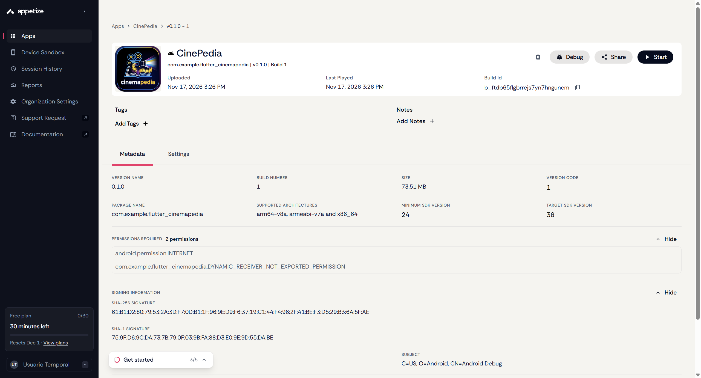
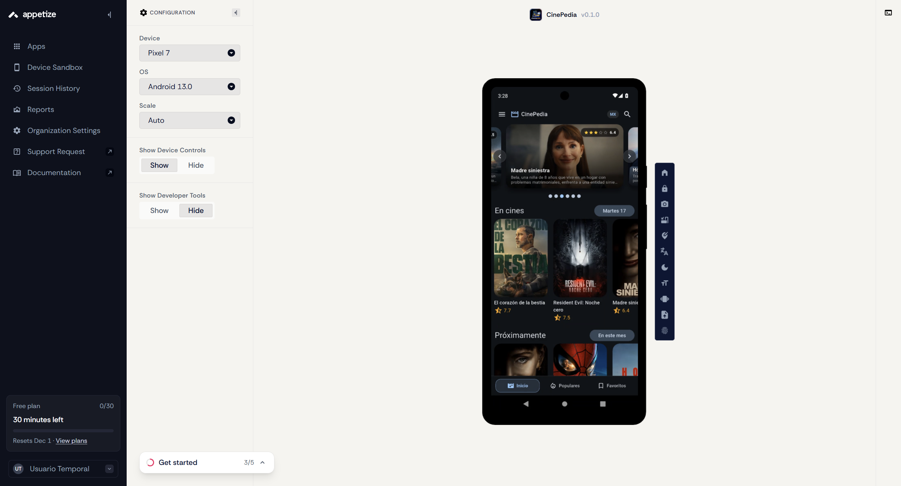
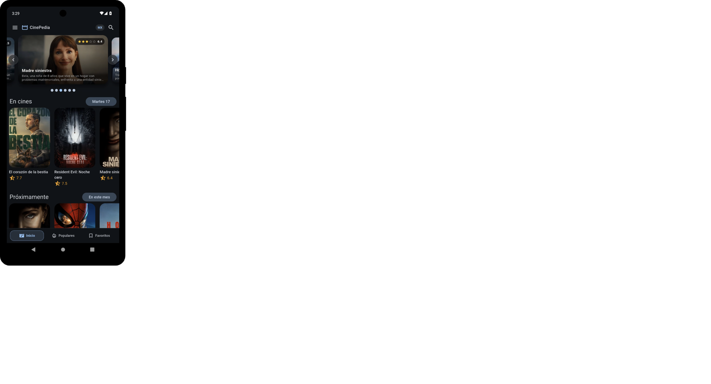
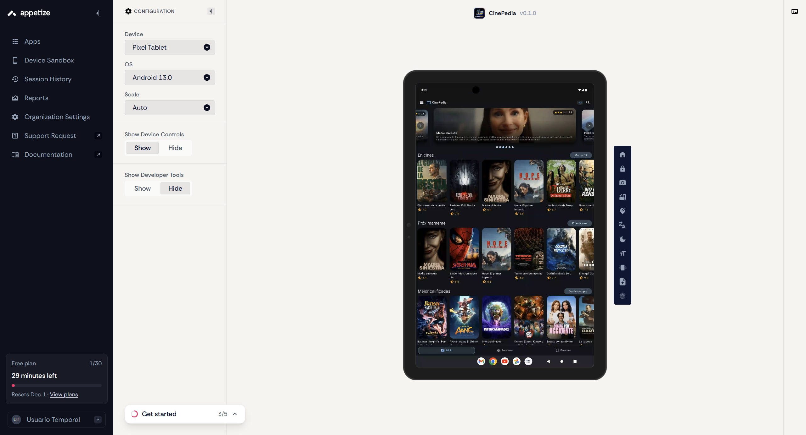

# Publicación y Validación de la Aplicación CinePedia en Appetize.io

<div align="center">

**UNIVERSIDAD TECNOLÓGICA DE XICOTEPEC DE JUÁREZ**  
**Ingeniería en Desarrollo y Gestión de Software**  
**Asignatura:** Desarrollo Móvil Integral (10° Cuatrimestre)

---

| **Docente** | **Alumno** | **Matrícula** | **Periodo** |
| :---: | :---: | :---: | :---: |
| M.T.I Marco Antonio Ramírez Hernández | **Francisco García García** | **230758** | Septiembre – Diciembre 2026 |

---

[](https://appetize.io/app/b_ftdb65flgbrrejs7yn7hnguncm)
[](https://appetize.io/app/b_ftdb65flgbrrejs7yn7hnguncm?device=pixel7&osVersion=13.0&toolbar=true)
[](https://appetize.io/app/b_ftdb65flgbrrejs7yn7hnguncm?device=pixeltablet&osVersion=13.0&toolbar=true)
[](https://flutter.dev)

</div>

---

## Descripción de la Práctica

En esta fase de despliegue se llevó a cabo el procedimiento formal de **compilación en modo producción (Release), publicación en la nube y evaluación funcional e interactiva** de la aplicación móvil **CinePedia** desarrollada en **Flutter** mediante la plataforma de virtualización [Appetize.io](https://appetize.io/).

A través de Appetize, el ejecutable empaquetado (`app-release.apk`) se ejecuta sobre entornos virtuales Android transmitidos mediante streaming WebRTC de baja latencia directamente en cualquier navegador web moderno. Esto permite validar el consumo en vivo de la API de **The Movie DB (TMDB)** para películas y series, el carrusel interactivo con estrellas y rate numérico, la internacionalización en 5 idiomas (`es-MX`, `en-US`, `de-DE`, `zh-CN`, `ar-EG`), la clasificación de edad por país, el almacenamiento local con **Isar** y **SharedPreferences**, el selector de temas claro/oscuro y por temporada, así como la adaptabilidad responsiva tanto en un teléfono inteligente (**Google Pixel 7**) como en una tableta de gran formato (**Google Pixel Tablet**) bajo Android 13.0.

---

## Objetivo de la Práctica

Publicar y validar la aplicación móvil **CinePedia** desarrollada en **Flutter** dentro de la plataforma **Appetize.io**, comprobando su funcionamiento en dispositivos virtuales Android en la nube, generando los enlaces públicos directos de acceso para revisión y evaluación docente, y documentando las evidencias técnicas, métricas de compilación, casos de prueba y análisis de adaptabilidad en el repositorio del proyecto.

---

## Enlaces Oficiales de Acceso en Appetize.io

* **Enlace Principal de la Aplicación en Appetize:**  
  **[https://appetize.io/app/b_ftdb65flgbrrejs7yn7hnguncm](https://appetize.io/app/b_ftdb65flgbrrejs7yn7hnguncm)**

* **Acceso Directo — Simulador Google Pixel 7 (Android 13.0):**  
  **[https://appetize.io/app/b_ftdb65flgbrrejs7yn7hnguncm?device=pixel7&osVersion=13.0&toolbar=true](https://appetize.io/app/b_ftdb65flgbrrejs7yn7hnguncm?device=pixel7&osVersion=13.0&toolbar=true)**

* **Acceso Directo — Simulador Google Pixel Tablet (Android 13.0):**  
  **[https://appetize.io/app/b_ftdb65flgbrrejs7yn7hnguncm?device=pixeltablet&osVersion=13.0&toolbar=true](https://appetize.io/app/b_ftdb65flgbrrejs7yn7hnguncm?device=pixeltablet&osVersion=13.0&toolbar=true)**

* **Vista de Reproducción Incrustada (Embed Player):**  
  **[https://appetize.io/embed/b_ftdb65flgbrrejs7yn7hnguncm?device=pixel7&scale=75&autoplay=true](https://appetize.io/embed/b_ftdb65flgbrrejs7yn7hnguncm?device=pixel7&scale=75&autoplay=true)**

---

## Ficha Técnica del Binario Compilado (APK Release)

El archivo ejecutable fue compilado con las optimizaciones de producción de Flutter y AOT (*Ahead-Of-Time*), reducción de recursos tipográficos (*tree-shaking* del 99.6%) y empaquetado multi-arquitectura mediante:

```bash
flutter build apk --release
```

| Parámetro Técnico | Especificación / Valor Registrado |
| :--- | :--- |
| **Nombre del Archivo** | `app-release.apk` |
| **Identificador de Paquete** | `com.example.flutter_cinemapedia` |
| **Versión de la Aplicación** | `0.1.0` (Build `1`) |
| **Ruta Local de Compilación** | `Practica06/flutter_cinemapedia/build/app/outputs/flutter-apk/app-release.apk` |
| **Tamaño del Binario** | **73.51 MB** (`77,079,578 bytes`) |
| **Algoritmo de Integridad** | `SHA-256` |
| **Firma Criptográfica SHA-256** | `B5AF2F1DB757779142C42C6093F830F448BF16F34FD252DFE307B4BE68836A80` |
| **Arquitecturas Compatibles** | Multi-ABI Universal (`arm64-v8a`, `armeabi-v7a`, `x86_64`) |
| **SDK Android** | Min SDK `24` • Target SDK `36` |
| **Permisos de Red Android** | `android.permission.INTERNET` (Declarado en `AndroidManifest.xml`) |
| **Herramientas de Compilación** | Flutter 3.47.4 • Dart 3.13.3 • Gradle 8.x • Material Design 3 |
| **Appetize Public Key** | `b_ftdb65flgbrrejs7yn7hnguncm` |
| **Fecha de Publicación** | 17 de Noviembre de 2026 |

---

## Evidencias Técnicas de Despliegue y Ejecución en Appetize.io

A continuación se presentan las capturas reales obtenidas durante la sesión de validación de la aplicación **CinePedia** en la plataforma Appetize.io, cubriendo el panel de registro del build, la ejecución en el smartphone Google Pixel 7, la vista incrustada y la tableta Google Pixel Tablet:

### 1. Panel de Control y Registro del Build en Appetize.io
* **Descripción:** Panel de administración de Appetize.io que confirma el registro del ejecutable `CinePedia` (`com.example.flutter_cinemapedia`), versión `0.1.0 (1)`, clave pública `b_ftdb65flgbrrejs7yn7hnguncm`, tamaño de `73.51 MB` y soporte multi-arquitectura (`arm64-v8a`, `armeabi-v7a` y `x86_64`).

<div align="center">



</div>

---

### 2. Dispositivo 1: Google Pixel 7 (Android 13.0) — Catálogo Principal en Ejecución
* **Descripción:** Aplicación **CinePedia** ejecutándose en tiempo real sobre el emulador **Google Pixel 7** en la nube. Se observa la barra superior con acceso al menú lateral e indicador de país (`MX`), el carrusel de estrenos con flechas laterales, título, sinopsis y badge superior con valoración en estrellas y rate numérico, seguido de los listados horizontales (*En cines* y *Próximamente*) y la barra inferior rediseñada (*Inicio*, *Populares*, *Favoritos*).

<div align="center">



</div>

---

### 3. Vista Embed Incrustada (Web Streaming WebRTC)
* **Descripción:** Vista limpia del reproductor WebRTC de Appetize a escala del 75%, mostrando la nitidez del renderizado Material Design 3, las tarjetas de películas cargadas desde The Movie DB y la navegación inferior activa.

<div align="center">



</div>

---

### 4. Dispositivo 2: Google Pixel Tablet (Android 13.0) — Adaptabilidad en Gran Formato
* **Descripción:** Ejecución de **CinePedia** sobre **Google Pixel Tablet**. La distribución de `CustomScrollView`, el carrusel principal y las tres listas horizontales (*En cines*, *Próximamente* y *Mejor calificadas*) se adaptan proporcionalmente al ancho de pantalla de la tableta, permitiendo visualizar simultáneamente múltiples pósters sin recortes ni desbordamientos.

<div align="center">



</div>

---

## Matriz de Casos de Prueba Validados en Appetize.io

| ID | Caso de Prueba | Procedimiento en Appetize | Dispositivo | Resultado Obtenido | Estado |
| :---: | :--- | :--- | :---: | :--- | :---: |
| **CP-01** | **Arranque y Splash Estacional** | Apertura de la URL pública y transición automática tras 5 segundos hacia `/home/0`. | Pixel 7 & Tablet | Animación fluida y salto automático a la pantalla principal sin bloqueos. | **APROBADO** |
| **CP-02** | **Carrusel con Estrellas, Rate y Flechas** | Revisión del `MoviesSlideshow` con autoplay circular, flechas laterales, título, sinopsis y estrellas + rate. | Pixel 7 & Tablet | Avance circular automático y manual; valoración en estrellas y rate legibles. | **APROBADO** |
| **CP-03** | **Consumo TMDB (Películas y Series)** | Carga de listas horizontales, Populares (Masonry) y conmutación entre Películas y Series en `SideMenu`. | Pixel 7 & Tablet | Peticiones HTTPS a `api.themoviedb.org/3` resueltas correctamente. | **APROBADO** |
| **CP-04** | **Multilenguaje (5 Idiomas) y Respaldo** | Cambio entre `es-MX`, `en-US`, `de-DE`, `zh-CN` y `ar-EG` en el menú lateral. | Pixel 7 | Interfaz y catálogo traducidos, dirección LTR mantenida en árabe y respaldo `en-US`. | **APROBADO** |
| **CP-05** | **Detalle, Clasificación de Edad y Tráiler** | Selección de un póster para abrir `MovieScreen` con reparto, similares, tráiler y badge de edad (`MX`, `US`, `FSK`, `NR`). | Pixel 7 | Clasificación por país, actores y recomendaciones renderizados sin errores. | **APROBADO** |
| **CP-06** | **Persistencia Local (Isar y Temas)** | Guardado de favoritos en Isar y cambio de tema claro/oscuro y paleta de temporada en `SharedPreferences`. | Pixel 7 | Estado conservado localmente dentro del contenedor virtual de Appetize. | **APROBADO** |
| **CP-07** | **Adaptabilidad en Tablet** | Ejecución completa en Google Pixel Tablet con Android 13.0. | Pixel Tablet | Escalado limpio de carruseles, grillas y barras de navegación. | **APROBADO** |

---

## Análisis Técnico y Adaptabilidad

1. **Compatibilidad Multi-ABI para Nube y Librerías Nativas (`Isar`):**  
   Al compilar el APK universal (`arm64-v8a`, `armeabi-v7a`, `x86_64`) con un peso contenido de **73.51 MB**, los binarios nativos de `isar_flutter_libs` funcionan de manera directa tanto en instancias virtuales x86_64 como ARM64 de Appetize sin errores de carga de librerías dinámicas (`.so`).

2. **Conectividad y Variables de Entorno Empaquetadas:**  
   La declaración de `<uses-permission android:name="android.permission.INTERNET"/>` en `AndroidManifest.xml` junto con la carga de `.env` mediante `flutter_dotenv` permiten que la aplicación consulte en tiempo real los endpoints de películas, series, créditos, videos y certificaciones de edad en TMDB desde el entorno virtualizado.

3. **Diseño Responsivo Multi-Dispositivo:**  
   La validación cruzada entre **Google Pixel 7** y **Google Pixel Tablet** comprueba que los `SliverAppBar`, `MoviesSlideshow`, `MovieHorizontalListview` y `MovieMasonry` se ajustan dinámicamente a distintas resoluciones y relaciones de aspecto.

---

## Conclusiones de Publicación

La publicación de **CinePedia** en **Appetize.io** cumple con todos los criterios de entrega y validación en la nube de la **Práctica 06**:
- Facilita la demostración y evaluación inmediata desde cualquier navegador web mediante enlaces directos.
- Verifica el desempeño en modo producción (*Release*) de la arquitectura limpia, el soporte dual de películas/series, los 5 idiomas y la base de datos local Isar.
